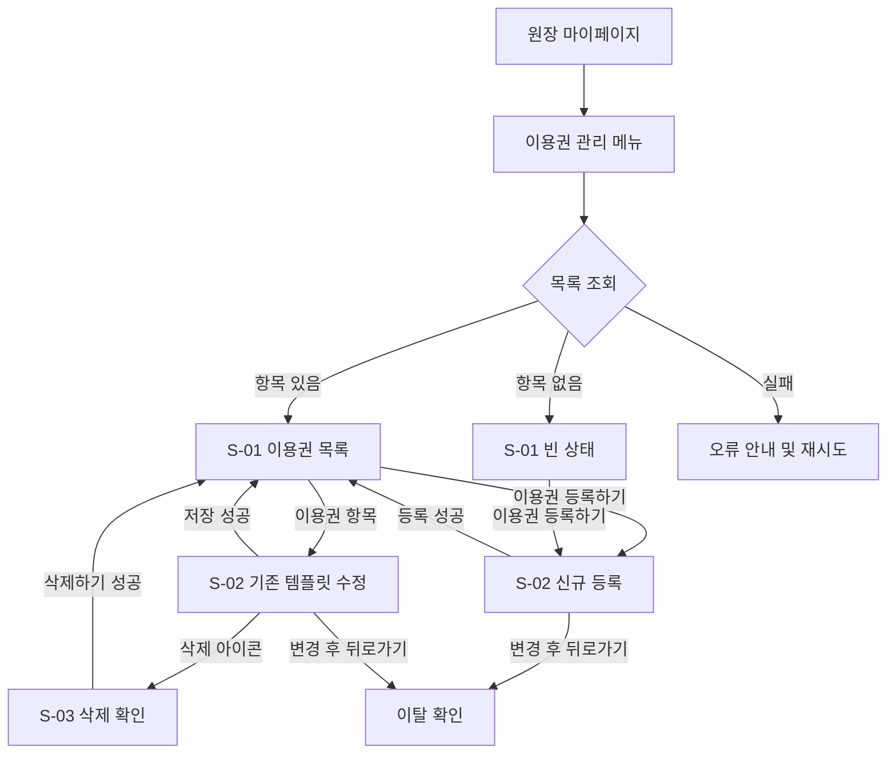

# [KD3-636] 이용권 등록 — 개발 기준 PRD

- 정리일: 2026-11-06 — 로컬 공통 정책 원문과 확정 OQ 반영
- 기준 원본: Figma `똑독 (Dev)`의 `V.4.0_원장-마이페이지` 섹션 (`23:4223`)
- 문서 원본 보관: `./original/`
- Figma 캐시 보관: `./figma/`
- 담당자 전달용 질문지: `../PRD-KD3-636-Open-Questions.md`
- 관련 에픽: [KD3-566] 4.0 유치원 이용 여정 확장
- Jira: https://jira-knockdog.atlassian.net/browse/KD3-636
- 구현 PR: #776

## 이 문서를 읽는 법

| 표시 | 뜻 | 기록 위치 |
|---|---|---|
| 표시 없음 | 여러 원본이 같은 내용을 말한다 | - |
| `(PRD 단독)` | PRD에만 있지만 명확하고 비충돌인 확정 요구사항 | 본문과 PRD 원본 위치 |
| `(Figma 단독)` | Figma에만 있지만 명확하고 비충돌인 확정 요구사항 | 본문과 Figma 위치 |
| `(DIFF-n)` | 문서와 Figma가 다르며 본문은 Figma를 따른다 | 9. PDF·문서와 Figma의 차이 |
| `(OQ-Pn)` | PRD 내용 중 모호하거나 추가 원본 확인이 필요한 질문 | 10. Open Questions |
| `(OQ-Fn)` | Figma 내용 중 모호하거나 내부 확인이 필요한 질문 | 10. Open Questions |
| `(OQ-Cn)` | 클라이언트에서 확인할 내용 | 10. Open Questions |
| `(OQ-Sn)` | 서버에서 확인할 내용 | 10. Open Questions |
| `(내 추론)` | 원본에 없고 정리 과정에서 추론한 내용 | 본문과 필요 시 OQ |

- 화면 순서와 UI 문구는 Figma를 우선한다.
- 제품 정책이 한쪽 원본에만 있어도 명확하고 다른 원본과 충돌하지 않으면 확정 반영하고 단독 출처를 표시한다.
- Figma 자체의 설명과 렌더 화면이 다르면 임의 확정하지 않고 OQ-F로 남긴다.

## 원본

| 원본 | 상태·편집일 | 원본 위치 | 보존 사본 |
|---|---|---|---|
| PRD Markdown | 문서 상태 `최신`; 최종 편집 `2026-10-29 14:41` | iCloud의 `[KD3-636] 이용권 등록 4006c15f67fb80219f7ee5a6ffa8b84b.md` | `./original/[KD3-636] 이용권 등록.md` |
| Figma 상위 섹션 | 파일 `똑독 (Dev)`; 최종 수정 `2026-11-04T05:24:02Z`; 읽기 권한 | [섹션 `23:4223`](https://www.figma.com/design/LiCUY2CN6tvNXbHziPpoh6/%EB%98%91%EB%8F%85--Dev-?node-id=23-4223&t=R9lkN6GRT2le9UO8-4) | `./figma/` |
| 프로젝트 공통 정책 | 로컬 원문; 2026-11-06 확인 | `docs/policy/loading-validation-error.md` | 프로젝트 공통 문서 원본을 직접 참조 |
| 서버 OpenAPI | 운영 Swagger 원문; 2026-11-06 확인 | [`https://api.knockdog.net/swagger-ui/index.html#/`](https://api.knockdog.net/swagger-ui/index.html#/) | 라이브 원문 직접 참조 |

## 1. 개요

원장이 `마이페이지`의 `이용권 관리`에서 자주 사용하는 이용권 구성인 이름, 충전 횟수, 유효기간을 템플릿으로 생성·조회·수정·삭제한다. 템플릿을 충전에 적용할 때는 값을 개별 이용권으로 복사하며, 이후 템플릿을 수정하거나 삭제해도 이미 충전된 이용권에는 영향을 주지 않는다.

- 템플릿 사용은 선택 사항이며 충전 화면에서 직접 입력하는 흐름도 유지한다. `(PRD 단독)`
- 보호자의 이용권 사용 현황 조회는 이 문서의 범위가 아니다. `(PRD 단독)`

출처: PRD 1장, Figma Description의 `이용권 관리 (S-01)`, `이용권 등록(S-02)`, `이용권 수정 (S-02)`

## 2. 범위

### 2.1 만드는 것

- 원장 마이페이지에서 `이용권 관리`로 진입하는 메뉴 `(Figma 단독)`
- 이용권 템플릿 목록, 빈 상태, 로딩·오류·재시도 상태
- 이름·충전 횟수·유효기간을 이용한 템플릿 등록
- 기존 템플릿 수정 및 삭제
- 등록·수정·삭제 성공과 실패 피드백
- 입력 중 이탈 확인과 중복 요청 차단
- 템플릿 값을 충전 시점에 복사하는 스냅샷 연동 지점 `(PRD 단독)`
- 유치원마다 `체험 등원(1회권)` 템플릿을 충전 1회·유효기간 없음으로 자동 생성하고, 생성 순서상 목록 최상단에 표시하며, 일반 템플릿과 동일하게 수정·삭제할 수 있게 한다. 기능 출시 전에 가입한 기존 유치원에도 출시 시점에 자동 생성한다. `(PRD 단독)`
- 기본 템플릿은 일반 템플릿처럼 삭제할 수 있고, 삭제 성공 후 목록에서 빠진 상태를 유지한다. 기본 템플릿까지 모두 삭제하면 빈 상태를 표시한다. `(PRD 단독)`

### 2.2 만들지 않는 것

다음 항목은 PRD에서 이번 범위 제외로 명시한다. `(PRD 단독)`

- 개별 원생 이용권 충전·조회·수정·삭제
- 등원예약에서 이용권을 소진하는 시점과 차감 로직
- 보호자의 이용권 사용 현황 조회
- 별도 알림 발송 `(PRD 단독)`

출처: PRD 2장·6장, Figma 설계번호 01~18

## 3. 사용자 흐름

- 목록은 오래된 템플릿부터 표시하며 수정해도 순서를 바꾸지 않는다.
- 상단 및 시스템 뒤로가기는 S-01에서 원장 마이페이지로, S-02에서는 S-01로 이동한다. 모달이 열려 있으면 모달을 먼저 닫는다.
- 이용권 템플릿 목록은 `/mypage/pass-templates`, 신규 등록은 `/mypage/pass-templates/create`, 수정은 `/mypage/pass-templates/[id]`를 사용한다. 세 화면 모두 `OwnerAccessGuard`를 적용하며, 원장이 아닌 사용자는 `/mypage`로 이동한다. S-01의 뒤로가기는 원장 마이페이지(`/mypage`)로, S-02의 뒤로가기는 S-01로 이동한다. 2026-11-06 사용자 결정.

출처: PRD 3장·4장·7.1장, Figma Description `2a`, `2b`, `3a`~`3C`, `4a`~`4c`

## 4. 공통 정책

### 4.1 목록과 정렬

- 현재 유치원에 등록된 모든 템플릿을 생성일시 오름차순으로 표시한다.
- 수정은 기존 순서를 바꾸지 않는다.
- 이름이 한 줄 영역을 넘으면 말줄임표 `…`로 처리한다.
- 보조 정보는 `{n}회 · {유효기간}` 형식이며, 만료가 없으면 `{n}회 · 만료 없음`으로 표시한다.
- 템플릿 개수 제한은 없다. `(PRD 단독)`
- 기본 `체험 등원(1회권)`은 충전 1회·유효기간 없음으로 자동 생성되며 생성 순서상 목록 최상단에 표시한다. 일반 템플릿과 동일하게 수정·삭제할 수 있고, 기능 출시 전에 가입한 기존 유치원에도 출시 시점에 자동 생성한다. `(PRD 단독)`

### 4.2 이름

- 필수 한 줄 텍스트, 최대 50자다.
- 같은 유치원 안에서 중복할 수 없다.
- 앞뒤 공백을 제거하고 연속 공백을 하나로 합친 값으로 중복 비교한다. `(PRD 단독)`
- 중복 오류는 Figma 기준 `이미 같은 이름의 템플릿이 있어요.`를 표시한다. `(DIFF-4)`
- 입력값을 바꾸면 중복 오류를 해제하고 다시 검사한다.
- 서버는 정규화한 이름의 중복을 최종 검증하고 `409 TICKET_TEMPLATE-409-1`을 반환한다. 프론트는 오류 `message`가 아니라 이 `code`를 기준으로 Figma 문구를 표시한다. Swagger는 대소문자 변환을 명시하지 않으므로 프론트에서 임의로 소문자화하지 않는다.

### 4.3 충전 횟수

- 필수이며 `1~1000` 정수만 허용한다.
- 숫자 키패드를 사용한다.
- 범위를 벗어나거나 정수가 아니면 `충전 횟수는 1~1000회 사이로 입력해 주세요.`를 표시하고 CTA를 비활성화한다.

### 4.4 유효기간

- `만료 없음`, `1개월`, `3개월`, `6개월`, `12개월`, `직접 입력` 중 하나를 선택한다.
- `직접 입력`은 `1~99` 숫자와 `일` 또는 `개월` 단위를 받는다.
- 다른 기간 칩을 선택하면 직접 입력 필드를 숨긴다.
- 신규 등록 화면에 처음 진입하면 유효기간은 아무것도 선택하지 않고 직접 입력 필드도 숨긴다. 2026-11-05 사용자 결정.
- 유효기간은 숫자·단위로 저장하고, `만료 없음`은 값 없이 저장하며, 충전 시작일 기준으로 만료일을 계산한다. `(PRD 단독)`

### 4.5 저장·삭제·이탈

- 유효한 필수값이 모두 입력된 경우에만 CTA를 활성화한다.
- 수정 화면은 기존 값과 달라진 유효한 값이 있을 때만 CTA를 활성화한다.
- 요청 직후 CTA를 비활성화하고 로딩을 표시해 중복 제출을 막는다.
- 실패하면 입력값을 유지하고 다시 시도할 수 있게 한다.
- 변경한 값이 있을 때 뒤로 가면 `이용권을 저장하지 않고 나갈까요?` 모달을 띄운다. `(DIFF-5)`
- 삭제 확인 중 뒤로 가면 모달만 닫고 수정 화면을 유지한다.
- 삭제 확인은 Figma 형태를 충족하는 공통 `@knockdog/ui`의 웹 `AlertDialog`를 재사용한다.
- 삭제 실패 시 확인 모달을 닫고 수정 화면과 입력값을 유지하며 `이용권을 삭제하지 못했어요` 토스트를 표시한다. 2026-11-05 사용자 결정.
- 브라우저·시스템·네이티브 뒤로가기는 동일한 우선순위로 처리한다. 삭제 확인 모달이 열려 있으면 모달만 닫고, 입력값이 변경됐으면 이탈 확인을 표시하며, 변경이 없으면 이전 화면으로 이동한다. 기존 `useNativeBackHandler`, `useUnsavedBrowserBackGuard`, `openOwnerUnsavedExitDialog` 조합을 재사용한다. 2026-11-06 사용자 결정.

### 4.6 공통 정책 문서

PRD 7.1장이 링크한 입력값·오류·로딩 정책은 로컬 원문 `docs/policy/loading-validation-error.md`에 통합 보존되어 있다. 2026-11-06 사용자 확인에 따라 이 파일을 KD3-636의 추가 원본으로 적용한다.

- 최초 목록 조회는 Header를 유지하고 콘텐츠 영역에 로딩을 표시하며, 250ms 이상 지속될 때 Spinner를 표시한다.
- 등록·수정·삭제 요청은 클릭 즉시 CTA를 비활성화하고 같은 요청의 중복 실행을 막으며, 250ms 이상 지속될 때 Spinner를 표시한다.
- 필수값이 비어 있거나 유효하지 않으면 CTA를 비활성화한다. 최대 길이 초과 입력은 입력 단계에서 차단하고, 형식 오류는 필드 이탈 시 인라인으로 표시하며 값이 유효해지면 즉시 해제한다.
- API 요청 전 문자열의 앞뒤 공백을 제거한다. 이용권 이름의 내부 공백은 KD3-636의 더 구체적인 규칙에 따라 연속 공백을 하나로 합친다.
- 목록 조회 실패는 Header를 유지한 콘텐츠 영역의 공통 `PageError`로 표시한다. 문구는 `정보를 불러오지 못했어요`, `잠시 후 다시 시도해 주세요.`, `다시 시도하기`를 사용한다.
- 재조회 중에는 재시도 중복 클릭을 막고, 자동 재시도 없이 사용자가 `다시 시도하기`를 누를 때만 다시 요청한다.
- 등록·수정·삭제 실패는 전체 오류 화면으로 전환하지 않고 현재 화면과 입력·선택값을 유지한다. 기능별 토스트를 표시한 뒤 CTA를 다시 활성화한다.
- 기능별 오류 분기는 서버의 `code`를 우선 사용하고 오류 `message` 문자열을 파싱하지 않는다.

출처: PRD 4장·5장·7장·7.1장, Figma Description, `docs/policy/loading-validation-error.md`

## 5. 상태

| 화면 | 상태 | 진입/발생 조건 | 본문 기준 동작 |
|---|---|---|---|
| S-01 | 목록 로딩 | 최초 진입·재조회 | 목록 영역에 로딩을 표시하고 응답 완료까지 유지 |
| S-01 | 목록 기본 | 템플릿 1개 이상 | 오래된 순서로 카드 표시, 하단 CTA 고정 |
| S-01 | 빈 목록 | 템플릿 0개 | `아직 등록된 이용권이 없어요`, `자주 사용하는 이용권을 등록할 수 있어요.` 표시 |
| S-01 | 목록 실패 | 조회 실패 | 공통 오류 안내와 재시도 제공; 빈 목록과 구분 |
| S-01 | 등록 완료 | 신규 등록 성공 | 목록 복귀 후 Figma 렌더의 `이용권이 등록됐어요` 표시 `(DIFF-9)` |
| S-01 | 저장 완료 | 수정 성공 | 목록 복귀 후 `이용권을 저장했어요` 표시 |
| S-01 | 삭제 완료 | 삭제 성공 | 항목 제거 후 `이용권을 삭제했어요` 표시 |
| S-02 | 신규 기본 | 등록 CTA 진입 | 빈 이름·횟수, 유효기간 미선택, 비활성 `등록하기` `(DIFF-1)` `(DIFF-2)` |
| S-02 | 이름 중복 | 서버 또는 클라이언트 중복 판정 | 인라인 오류, 값 유지, CTA 비활성 `(DIFF-4)` |
| S-02 | 횟수 오류 | `1~1000` 정수 위반 | 인라인 오류, 값 유지, CTA 비활성 |
| S-02 | 등록 실패 | 등록 요청 실패 | 화면·값 유지, `이용권을 등록하지 못했어요` 토스트 `(DIFF-8)` |
| S-02 | 수정 기본 | 목록 항목 선택 | 기존 값과 삭제 아이콘 표시, 변경 전 CTA 비활성 |
| S-02 | 저장 실패 | 수정 요청 실패 | 화면·값 유지, `이용권을 저장하지 못했어요` 토스트 |
| S-02 | 삭제 실패 | 삭제 요청 실패 | 확인 모달 닫기, 수정 값 유지, `이용권을 삭제하지 못했어요` 토스트 |
| S-02 | 작성 중 이탈 | 변경 후 뒤로가기 | 이탈 확인 모달 표시 |
| S-03 | 삭제 확인 | 수정 화면의 삭제 아이콘 | `닫기` 또는 `삭제하기` 선택 |

출처: PRD 7장, Figma 설계번호 02~18

## 6. 데이터 항목

| 항목 | 필수 | 개발 기준 | 확인 상태 |
|---|---|---|---|
| 템플릿 ID | Y | 서버 `int64` 식별자 | `(PRD 단독)`, Swagger `TicketTemplateResponse.id` |
| 유치원 식별자 | 요청에 없음 | Bearer 인증된 원장이 관리하는 현재 유치원 범위로 서버가 제한 | Swagger endpoint 설명·`OWNER_FORBIDDEN` |
| 템플릿 이름 | Y | 최대 50자, 유치원 내 중복 불가 | 정규화 방식 `(PRD 단독)`, Swagger `TICKET_TEMPLATE-409-1` |
| 충전 횟수 | Y | `1~1000` 정수(`int32`) | Swagger `TicketTemplateRequest.chargeCount` |
| 유효기간 숫자 | 조건부 | 직접 입력이면 `1~99`, 만료 없음이면 `null` | 저장 형식 `(PRD 단독)`, Swagger `validityValue` |
| 유효기간 단위 | 조건부 | `DAY` 또는 `MONTH`, 만료 없음이면 `null` | 저장 형식 `(PRD 단독)`, Swagger `validityUnit` |
| 생성일시 | 응답 미노출 | 서버가 먼저 생성한 템플릿부터 정렬해 반환 | `(PRD 단독)`, Swagger 목록 설명 |
| 수정일시 | N | 수정한 적 없으면 비어 있고 목록에는 표시하지 않음 | `(PRD 단독)` |

스냅샷은 충전 시점에 이름·충전 횟수·유효기간을 개별 이용권으로 복사하는 방식이다. `(PRD 단독)` 개별 이용권 충전 API와 동시성은 이번 범위에 포함하지 않는다.

출처: PRD 4장·5장, Figma Description `2a`, `3a`, `4a`

### 6.1 서버 API 계약

- Bearer 인증을 사용하며 원장이 관리하는 현재 유치원 범위로 서버가 제한한다.
- `GET /api/v0/owner/school/ticket-templates`: 생성 순서의 전체 목록을 `templates` 배열로 반환한다. pagination은 없다.
- `POST /api/v0/owner/school/ticket-templates`: 템플릿을 등록하고 생성된 `TicketTemplateResponse`를 반환한다.
- `PUT /api/v0/owner/school/ticket-templates/{templateId}`: `int64` ID의 템플릿을 수정하고 수정된 응답을 반환한다.
- `DELETE /api/v0/owner/school/ticket-templates/{templateId}`: 템플릿을 삭제한다.
- 요청 DTO는 `name`, `chargeCount`, 조건부 `validityValue`, `validityUnit`을 사용한다. 응답은 여기에 `id`를 더한다.
- `validityValue`는 nullable 정수, `validityUnit`은 nullable `DAY | MONTH`다. 만료 없음은 두 값을 모두 `null`로 보낸다.
- 공통 오류는 `status`, `code`, `message`, 선택적 `errorMessage` 형태다. 원장 권한 없음은 `OWNER-403-1`, 중복 이름은 `TICKET_TEMPLATE-409-1`, 없거나 다른 유치원 템플릿은 `TICKET_TEMPLATE-404-1`이다.
- Swagger에는 단건 상세 조회 `GET /api/v0/owner/school/ticket-templates/{templateId}`가 없다. 수정 화면은 목록 API를 조회한 뒤 URL의 `templateId`와 같은 항목을 찾아 표시한다. 직접 진입·새로고침도 동일하게 처리하며 항목이 없으면 이용권 목록 화면(`/mypage/pass-templates`)으로 이동하고 `이용권을 찾을 수 없어요` 토스트를 표시한다. 2026-11-06 구현 기준 확정, 2026-11-09 사용자 결정으로 not-found 처리 방식 확정.

출처: 운영 Swagger `/v3/api-docs`; 2026-11-06 확인

## 7. 화면 명세

Figma의 설계번호 순서를 구현·검수 순서로 사용한다. 렌더 PNG는 `./figma/images/`에 있다.

| 설계번호 | 화면·상태 | Figma 근거 | 개발 기준 |
|---|---|---|---|
| 01 | 마이페이지 진입 | `23:4393` | `유치원 관리`에 `이용권 관리`와 `자주 사용하는 이용권을 관리 할 수 있어요.` 표시, 탭 시 S-01 이동 `(Figma 단독)` |
| 02 | S-01 목록 기본 | `23:4515` | 카드에 이름과 `충전 횟수 · 유효기간`; 하단 `이용권 등록하기` 고정 |
| 03 | S-01 빈 상태 | `23:4837` | `아직 등록된 이용권이 없어요`, `자주 사용하는 이용권을 등록할 수 있어요.` |
| 04 | S-02 신규 등록 | `23:4529` | 헤더 `이용권 관리`, 이름 placeholder `이름을 입력하세요.`, CTA `등록하기` `(DIFF-1)` `(DIFF-2)` `(DIFF-3)` |
| 05 | S-02 입력 상태 | `23:4787` | 입력에 따라 카운터와 CTA 상태 갱신 |
| 06 | S-02 직접 입력 | `23:4812` | 숫자 필드와 `일`·`개월` 단일 선택 표시 |
| 07 | S-02 등록 완료 전 | Figma 설계 라벨 07 | 요청 중 CTA 비활성화·로딩, 중복 제출 차단 |
| 08 | S-02 이름 중복 | `23:4762` | `이미 같은 이름의 템플릿이 있어요.` `(DIFF-4)` |
| 09 | S-02 입력 오류 | `23:4555` | `충전 횟수는 1~1000회 사이로 입력해 주세요.` |
| 10 | S-02 기존 템플릿 수정 | `23:4605` | 헤더에 템플릿 이름, 삭제 아이콘, 기존 값; CTA는 Figma 기준 `등록하기` `(DIFF-2)` |
| 11 | S-02 수정 및 삭제 진입 | Figma 설계 라벨 11 | 변경 여부와 삭제 진입을 구분 |
| 12 | S-03 삭제 확인 | `23:4709` | `이용권을 삭제할까요?`, `이미 충전한 이용권은 그대로 사용할 수 있어요`, `닫기`, `삭제하기` `(DIFF-6)` `(DIFF-7)` |
| 13 | S-01 삭제 완료 | `23:4239` | 삭제 항목 제거 및 `이용권을 삭제했어요` 토스트 표시. 2026-11-05 사용자 결정 |
| 14 | S-02 저장 실패 | `23:4630` | `이용권을 저장하지 못했어요` |
| 15 | S-02 삭제 실패 | `23:4656` | 확인 모달을 닫고 수정 화면에 `이용권을 삭제하지 못했어요` 토스트 표시. 2026-11-05 사용자 결정 |
| 16 | S-01 결과 상태 | `23:4224` | 요청 결과 반영 후 목록과 토스트 표시 |
| 17 | S-01 목록/토스트 | `23:4357` | 등록 완료 토스트 `이용권이 등록됐어요` `(DIFF-9)` |
| 18 | S-02 편집 폼 | `23:4736` | 등록 실패 토스트 `이용권을 등록하지 못했어요` `(DIFF-8)` |

### 7.1 Figma 치수 기준

- 기본 모바일 프레임은 `390 × 844`다. `(Figma 단독)`
- 본문 좌우 여백은 렌더 기준 `16px`, 주요 필드·카드·CTA 폭은 `358px`다. `(Figma 단독)`
- 하단 CTA 높이는 `56px`이며 Safe Area 위에 고정한다. `(Figma 단독)`
- 실제 구현 시 나머지 간격·타이포그래피·색상·모서리·테두리는 캐시된 원본 JSON 수치를 기준으로 대조한다. `(Figma 단독)`

## 8. 알림

템플릿 생성·수정·삭제에 별도 푸시·문자·이메일 알림을 추가하지 않는다. 화면 내 토스트는 제공한다. `(PRD 단독)`

출처: PRD 6장

## 9. PDF·문서와 Figma의 차이

### 확인이 필요한 차이

현재 확인이 필요한 차이는 없다.

### 확정된 차이

펼쳐 보기

| ID | 항목 | PDF·문서 원문 | Figma 원문·본문 기준 | 처리 상태 | 본문 위치 |
|---|---|---|---|---|---|
| DIFF-1 | 신규 등록 화면 제목 | `타이틀: 이용권 등록하기` | 렌더 `이용권 관리`; Description `이용권 등록`; 2026-11-05 사용자 결정으로 `이용권 관리` 확정 | 확정 — 사용자 결정 | 5장, 7장 |
| DIFF-2 | 등록·수정 CTA | `버튼: 저장하기` | 렌더 `등록하기` | 확정 — Figma 기준 | 4.5장, 5장, 7장 |
| DIFF-3 | 이름 placeholder | `placeholder: 예) 10회권` | `이름을 입력하세요.` | 확정 — Figma 기준 | 7장 |
| DIFF-4 | 이름 중복 오류 | `이미 같은 이름의 이용권이 있어요.` | `이미 같은 이름의 템플릿이 있어요.` | 확정 — Figma 기준 | 4.2장, 5장, 7장 |
| DIFF-5 | 이탈 확인 제목 | `저장하지 않고 나갈까요?` | `이용권을 저장하지 않고 나갈까요?` | 확정 — Figma 기준 | 4.5장 |
| DIFF-6 | 삭제 확인 제목 | `등록된 이용권을 삭제할까요?` | `이용권을 삭제할까요?` | 확정 — Figma 기준 | 7장 |
| DIFF-7 | 삭제 확인 본문 문장부호 | `이미 충전한 이용권은 그대로 사용할 수 있어요.` | `이미 충전한 이용권은 그대로 사용할 수 있어요` | 확정 — Figma 기준 | 7장 |
| DIFF-8 | 신규 등록 실패 토스트 | `이용권을 저장하지 못했어요` | `이용권을 등록하지 못했어요` | 확정 — Figma 기준 | 5장, 7장 |
| DIFF-9 | 신규 등록 성공 토스트 | `이용권을 등록했어요` | `이용권이 등록됐어요` | 확정 — Figma 기준 | 5장, 7장 |

## 10. Open Questions

### PDF·문서에서 확인이 필요한 내용

현재 열린 PDF·문서 질문은 없다. FR-05의 기본 `체험 등원(1회권)` 제공 정책은 원본 한 곳에만 있지만 내용이 명확하고 다른 원본과 충돌하지 않아 `(PRD 단독)` 확정 요구사항으로 본문에 반영했다.

### 클라이언트에 확인할 내용

| ID | 질문 | 근거 | 현재 구현 | 본문 위치 |
|---|---|---|---|---|
| OQ-C3 | 공용 컴포넌트의 현재 값과 Figma 값이 다른 곳은 어느 쪽이 기준인가? 공용 컴포넌트 담당 팀원의 확인이 필요하다. | 최신 `develop`의 공용 컴포넌트로 구현한 뒤 `390 × 844`에서 측정한 차이: ① 작은 글자(`caption1-regular`: 글자 수 `n/50`, 목록 보조 문구, 오류 문구) 줄 높이 Figma `18px`, 실제 `16px`이고 이 때문에 목록 항목 높이도 Figma `80px`, 실제 `78px` ② 직접 입력 `일`·`개월` 버튼 너비 Figma `67px`, 실제 `69px` ③ 헤더 제목 Figma `20/28`, 실제 `18/26`(`h3-extrabold`) ④ 삭제 확인 창(`AlertDialog`) Figma `326 × 184`·모서리 `16px`·설명 `14/20`, 실제 `334 × 196`·모서리 `12px`·설명 `16/24` ⑤ `직접 입력` 칩의 선택 전 테두리가 공용 컴포넌트는 점선이며 Figma의 점선 여부는 확인하지 못함 | 2026-11-09 — 확인 전까지 공용 컴포넌트를 그대로 사용한다(값 덮어쓰기·공용 코드 수정 없음) | 7.1장(관련) |

### 서버에 확인할 내용

| ID | 질문 | 근거 | 현재 구현 | 본문 위치 |
|---|---|---|---|---|
| OQ-S3 | 만료 없음 템플릿을 등록·수정할 때 `validityValue`·`validityUnit`을 `null`로 보내는 것과 필드를 생략하는 것이 서버에서 같은 동작인가? 한 필드만 보냈을 때는 어떻게 처리하는가? | PRD 6.1은 두 값을 모두 `null`로 보낸다고 적었고, Swagger는 '생략'이라고 적었다 | 2026-11-09 — 서버 확인 전까지 두 값을 모두 `null`로 보낸다(임시) | 4.4장, 6.1장 |

### 확정된 질문

펼쳐 보기

| ID | 원래 내용 | 위치 | 확인 결과 | 본문 반영 위치 |
|---|---|---|---|---|
| OQ-F3 | 신규 등록 유효기간 초기 상태 | Figma `23:4529` | 2026-11-05 — 아무 기간도 선택하지 않은 상태로 시작 | 4.4장, 5장 |
| OQ-F4 | 신규 등록 화면 제목 | Figma 렌더·Description·PRD 충돌 | 2026-11-05 — `이용권 관리` | 7장, DIFF-1 |
| OQ-F5 | 삭제 완료 토스트 | Figma 렌더·Description 충돌 | 2026-11-05 — `이용권을 삭제했어요` | 5장, 7장 |
| OQ-F6 | 삭제 실패 시 모달 상태 | Figma Description·렌더·PRD 충돌 | 2026-11-05 — 모달을 닫고 수정 화면에 실패 토스트 표시 | 4.5장, 5장, 7장 |
| OQ-P8 | 입력값·오류·로딩 공통 정책 원문 적용 | PRD 7.1장, `docs/policy/loading-validation-error.md` | 2026-11-06 — 저장소의 로컬 공통 정책 원문을 추가 원본으로 적용 | 원본 표, 4.6장, 5장 |
| OQ-C1 | 라우트와 접근 제한 | 미커밋 목업 초안의 라우트·`OwnerAccessGuard` | 2026-11-06 — 목업의 URL 구조를 유지하고 세 화면을 원장 전용으로 제한하며, 비원장은 `/mypage`로 이동 | 3장 |
| OQ-C2 | 뒤로가기와 작성 중 이탈 | 기존 원장 편집 화면의 공통 훅 조합 | 2026-11-06 — 모달을 먼저 닫고, 변경값이 있을 때만 이탈 확인을 표시하며, 변경값이 없으면 이전 화면으로 이동 | 4.5장 |
| OQ-S1 | CRUD 기본 계약과 수정 화면의 상세 값 공급 | 운영 Swagger `/v3/api-docs` | 2026-11-06 — 목록·생성·수정·삭제 계약을 적용하고, 별도 상세 GET 없이 목록 조회 후 `templateId`로 항목을 찾음 | 6장·6.1장 |
| OQ-S2 | 이름 중복 정규화와 오류 계약 | 운영 Swagger `TicketTemplateRequest`, 등록·수정 409 응답 | 2026-11-06 — 앞뒤·연속 공백 정규화 후 서버가 최종 중복 검증하고 `TICKET_TEMPLATE-409-1`을 반환; 프론트는 code를 Figma 오류 문구로 매핑 | 4.2장, 6장·6.1장 |

### 우선 답변이 필요한 블로커

현재 이용권 템플릿 등록·수정·삭제 구현과 TC 작성을 막는 열린 OQ는 없다. OQ-S3은 서버 답변 전까지 `null` 전송으로 임시 진행하며, 답변에 따라 요청 변환만 바꾸면 된다. OQ-C3은 팀원 확인 전까지 공용 컴포넌트를 그대로 쓰며, 답변에 따라 공용 컴포넌트가 바뀌면 이 화면은 따라간다.

## 11. 구현할 때 놓치기 쉬운 점

이 장은 원본 요구사항이 아니라 2026-11-04 코드베이스를 읽으며 남긴 구현 메모다.

- 미커밋 목업 초안은 `apps/knockdog/src/views/mypage/ui/Mypage.tsx`에 `유치원 관리` 메뉴 섹션을 추가했지만, OQ 해결 전 임시 구현이므로 완료 근거로 사용하지 않는다.
- 미커밋 목업 초안의 `apps/knockdog/src/shared/constants/route.ts`와 `apps/knockdog/app/(stack)/mypage/pass-templates`에 추가된 라우트·가드는 OQ-C1에서 확정한 URL 구조와 원장 전용 접근 기준에 맞는지 구현 단계에서 검증한다.
- 입력 이탈은 `useNativeBackHandler`, `useUnsavedBrowserBackGuard`, `openOwnerUnsavedExitDialog` 조합을 재사용한다. 모달이 열렸을 때 뒤로가기를 먼저 소비하는 순서를 구현 단계에서 검증한다.
- 공통 `Header`, `TextField`, `ActionButton`, `AlertDialog`, `toast`, `Divider`를 우선 재사용한다. 삭제 확인 UI는 기존 `AlertDialog`로 Figma 형태를 구현한다. Figma 내부 stroke는 CSS 바깥 테두리로 크기를 키우지 않도록 구현 단계에서 확인한다.
- 프론트 코드베이스에는 실제 이용권 템플릿 API 클라이언트가 아직 없지만 운영 Swagger에는 `/api/v0/owner/school/ticket-templates` 계약이 있다. 이름이 비슷한 `owner-notice-template`은 알림장 템플릿이므로 재사용하지 않는다.
- 수정 화면은 별도 상세 endpoint를 가정하지 않고 목록 조회 결과에서 `templateId`로 항목을 찾는다. 직접 진입·새로고침에서 목록 로딩·오류·not-found 상태를 구분한다.
- 목록 CTA는 스크롤과 항목 수에 관계없이 Safe Area 위에 고정한다. 긴 목록에서 마지막 카드가 CTA에 가리지 않도록 하단 여백을 확보한다.
- 목록 생성 순서는 서버가 보장하므로 클라이언트에서 다시 정렬하지 않고, 수정 성공 후 재조회해도 순서가 바뀌지 않는지 확인한다.
- 등록·저장·삭제 요청 중 CTA 연타, 화면 이탈, 시스템 뒤로가기, 다른 기기에서 이미 삭제된 항목을 모두 별도 상태로 검증한다.
- 구현 후 Figma 캐시의 `390 × 844` 프레임과 같은 viewport에서 Playwright로 카드·필드·고정 CTA의 bounding box를 비교한다.
