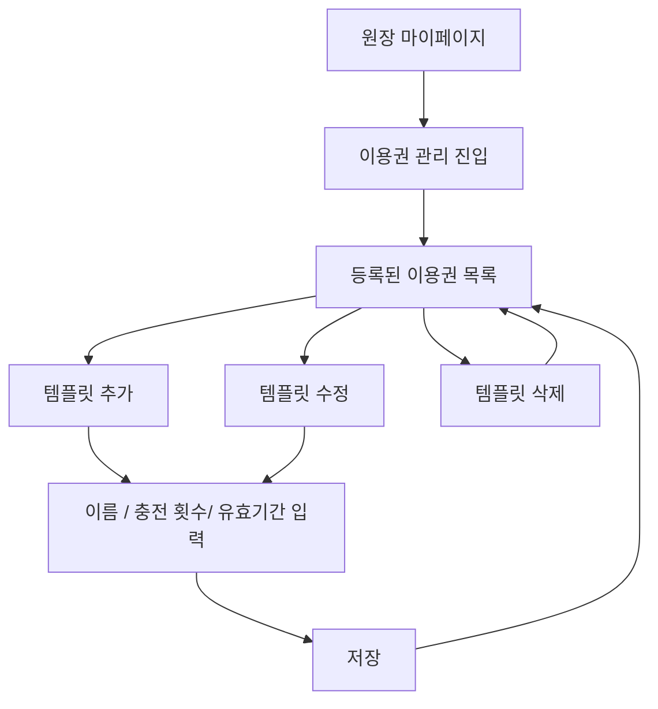

# [KD3-636] 이용권 등록

관련 에픽: [KD3-566] 4.0 유치원 이용 여정 확장 (https://app.notion.com/p/KD3-566-4-0-3fe6c15f67fb8080babbefb5564d8c2a?pvs=21)
분류: 원장
문서 상태: 최신
담당: PM_서현
지라 티켓: https://jira-knockdog.atlassian.net/browse/KD3-636
최종 편집 일시: 2026년 10월 29일 오후 2:41

## 1. 개요

### 1.1. 한 줄 요약

원장이 `마이페이지` > `이용권 관리`에서 자주 쓰는 이용권 구성(이름·충전 횟수·유효기간)을 템플릿으로 저장해두고, 충전할 때 선택해서 빠르게 불러와 쓸 수 있게 한다.

### 1.2. 도입 배경

- 현재 상황
    - 이번 똑독 v4.0에서 원생(강아지) 단위 이용권을 횟수권으로 도입한다.
    - 이용권 충전은 원생 프로필에서 이름·충전 횟수·유효기간을 직접 입력하는 방식으로 설계한다.
- 문제
    - 이용권을 신규로 도입하면서 충전할 때마다 같은 구성을 반복 입력해야 한다면 충전 작업이 번거롭고 입력 실수가 발생할 수 있다.

### 1.3. 도입 목적

- 자주 쓰는 구성을 템플릿 형태로 저장해두고 충전 시 선택만으로 값을 채울 수 있도록 한다.
- 템플릿은 선택 사항이며 즉석에서 직접 입력해 충전하는 기존 흐름도 그대로 유지한다.
- 템플릿을 수정·삭제해도 이미 충전된 개별 이용권에는 영향이 없도록 해 데이터 일관성을 보장한다.
- 보호자가 본인의 이용권 사용 현황을 확인하는 문제는 이 PRD의 범위가 아니다.

### 1.4. 관련 문서

- [이용권 정의](https://app.notion.com/p/3ff6c15f67fb800d89c6cd89a128290d?pvs=21): 이용권의 정의·속성·라이프사이클(홀딩 포함)
- [[KD3-643] 충전 및 관리](https://app.notion.com/p/KD3-643-4006c15f67fb80ebbd74f4426582b49f?pvs=21) : 템플릿을 적용한 실제 충전은 해당 문서에서 다룬다.
- [템플릿 목록·수정·삭제 화면 (Figma)](https://www.figma.com/design/93NxP3OOpa3BfnGTH0dNl2/?node-id=10790-61949): PM 초안 와이어프레임

## 2. 범위

### 2.1. 이 문서가 다루는 범위

- 원장님 앱의 `마이페이지` > `이용권 관리`에서 이용권 템플릿을 생성·조회·수정·삭제하는 기능을 정의한다.
- 템플릿 값이 충전 화면에 어떻게 전달되는지(스냅샷 방식)의 연동 지점까지 다루되 실제 충전 처리나 개별 이용권의 CRUD 자체는 다루지 않는다.
    - 스냅샷이란?
        
        충전하는 순간 템플릿 값을 그대로 복사해서 개별 이용권에 저장함. 충전 이후 템플릿과 이용권은 서로 연결되지 않는다. 
        

### 2.2. 제외 범위

| 제외 항목 | 제외 사유 | 후속 위치 |
| --- | --- | --- |
| 개별 원생 이용권 충전·조회·수정·삭제 | 원생 프로필(원생 탭 > 원생 목록 > 원생 프로필 > 반려견 정보 > 이용권) 화면에서 이뤄지는 별도 기능이며 이용권 관리와 화면 위치가 다르다. | [이용권] 충전 및 관리 PRD |
| 등원예약에서의 이용권 소진(차감) 로직 | 이용권 소진 시점과 차감 로직은 등원예약 기능의 책임 범위다. | 등원예약 PRD |
| 보호자의 이용권 사용 현황 조회 | 이용권 관리와 무관한 별도 기능이며 화면 위치도 다르다. |  |

## 3. 사용자 흐름

## 4. 기능 요구사항

| ID | 요구사항 | 기능 | 정책 |
| --- | --- | --- | --- |
| FR-01 | 등록된 이용권 목록 조회 | 원장은 이용권 관리에서 저장된 이용권 템플릿을 목록으로 확인할 수 있다. |   • 이용권 이름·충전횟수·유효기간 표시
  • 생성일시 오름차순(먼저 만든 템플릿이 위). 수정해도 목록 순서는 바뀌지 않는다 |
| FR-02 | 이용권 생성 | 원장은 이름·충전·유효기간을 입력해 새 템플릿을 저장할 수 있다. |   • 충전은 1~1000까지 입력 가능
  • 유효기간 기간 칩(만료 없음·1개월·3개월·6개월·12개월) 중 하나를 고르거나 직접 입력(숫자 + 일·개월)으로 정한다. 만료 없음이면 만료일 없이 사용한다
  • 템플릿 이름은 중복 불가
  • 템플릿 개수 제한 없음 |
| FR-03 | 이용권 수정 | 원장은 기존 템플릿의 이름·충전·유효기간을 수정할 수 있다. |   • 수정 내용은 이후 신규 충전 시에만 적용된다
  • 이미 충전된 개별 이용권에는 영향을 주지 않는다(스냅샷 방식) |
| FR-04 | 이용권 삭제 | 원장은 템플릿을 삭제할 수 있다. |   • 삭제해도 이미 충전된 개별 이용권에는 영향을 주지 않는다 |
| FR-05 | 기본 템플릿 제공 | 유치원마다 "체험 등원(1회권)" 템플릿이 자동으로 생성되어 있다. |   • 충전 1회, 유효기간 없음(만료 없음)
  • 가장 먼저 생성되므로 목록 최상단에 위치
  • 일반 템플릿과 동일하게 수정·삭제 가능
  • 기능 출시 전에 가입한 기존 유치원에도 출시 시점에 자동 생성 |

## 5. 입력 및 데이터 항목

| 항목 | 필수 | 정책 |
| --- | --- | --- |
| 템플릿 ID | Y | 이용권 템플릿 식별에 사용한다. |
| 템플릿 이름 | Y | 한 줄 자유 텍스트, 최대 50자. 같은 유치원 안에서 중복 불가(정규화한 값으로 비교) |
| 충전 횟수 | Y | 1~1000 정수 |
| 유효기간 | Y | 기간 칩 또는 직접 입력(숫자(1~99) + 일·개월)으로 입력하고, 숫자와 단위로 저장한다. 만료 없음을 고르면 값 없이 저장한다. 충전 시 원장이 정한 시작일을 기준으로 이용권 만료일을 계산한다. |
| 생성일시 | Y | 템플릿 생성 시각. 목록 정렬 기준으로 사용한다. |
| 수정일시 | N | 마지막 수정 시각. DB에만 저장하고 목록에는 표시하지 않는다. 수정한 적이 없으면 비어 있다. |
- 템플릿은 스냅샷 방식으로 적용된다: 충전 시점에 템플릿의 이름·충전횟수·유효기간 값이 개별 이용권으로 복사되고(만료일은 충전 때 정한 시작일 기준으로 계산) 이후 템플릿이 수정·삭제되어도 이미 충전된 이용권에는 영향을 주지 않는다.
- 입력·검사·오류 처리는 7.1의 공통 정책을 따른다.

## 6. 알림

해당 없음 

- 템플릿 생성·수정·삭제는 원장 본인이 이용권 관리에서 수행하는 작업으로 별도 알림을 추가하지 않는다.

## 7. 화면 구성 및 UX 문구

| ID |  | 화면명 | 상태 | 기본 화면 구성 | 표시·동작 및 이동 | UX 문구 | 디자인 상황 |
| --- | --- | --- | --- | --- | --- | --- | --- |
| S-01 |  | 이용권 등록 목록 | 기본 | 상단 내비게이션, 등록된 이용권 목록, 이용권 등록하기 버튼 | 항목마다 이용권 이름과 충전 횟수·유효기간을 표시한다. 이름이 한 줄을 넘으면 말줄임(…)으로 처리한다. 항목을 누르면 S-02(수정), 버튼을 누르면 S-02(추가)로 이동한다. | 타이틀: 이용권 관리
항목 보조 정보: {n}회 · {유효기간} / {n}회 · 만료 없음
버튼: 이용권 등록하기 | 완료 |
|  |  | 이용권 등록 목록 | 목록 없음 | 빈 상태, 이용권 등록하기 버튼 | 기본 등록된 이용권까지 모두 삭제했을 때 표시한다. | 제목: 아직 등록된 이용권이 없어요.
본문: 자주 사용하는 이용권을 등록할 수 있어요.
버튼: 이용권 등록하기 | 완료 |
|  |  | 이용권 등록 목록 | 삭제 완료 | 기본 화면 + 토스트 | S-03에서 삭제하면 목록으로 돌아와 토스트를 표시한다. 삭제한 항목은 목록에서 빠진다. | Toast: 이용권을 삭제했어요 | 완료 |
| S-02 |  | 이용권 추가 | 기본 | 이용권 이름·충전 횟수·유효기간 입력, 저장하기 버튼 | 유효기간은 칩 하나를 고른다. 직접 입력을 누르면 숫자 입력칸과 단위(일·개월) 선택이 열린다. 필수값(이용권 이름·충전 횟수), 유효기간이 모두 작성되면 저장하기 버튼이 활성화된다. 저장하면 목록으로 돌아가고 새로 등록된 이용권은 목록 맨 아래에 추가된다. | 타이틀: 이용권 등록하기
라벨: 이용권 이름 · 충전 횟수 · 유효기간 (선택)
placeholder: 예) 10회권 · 1~1000
카운터: {n}/50
유효기간 칩: 만료 없음 · 1개월 · 3개월 · 6개월 · 12개월 · 직접 입력
직접 입력 단위: 일 · 개월
버튼: 저장하기

Toast: 이용권을 등록했어요 | 완료 |
|  |  | 이용권 수정 | 기본 | 저장된 값이 채워진 입력 필드, 오른쪽 상단 휴지통 아이콘, 저장하기 버튼 | 저장된 유효기간이 칩에 없는 값(예: 80일)이면 직접 입력이 선택된 상태로 값을 채운다. 기존 값과 달라진 값이 있고 모든 값이 유효할 때 저장하기 버튼이 활성화된다. 휴지통 아이콘을 누르면 S-03을 표시한다. | 타이틀: {이용권 템플릿 이름}
버튼: 저장하기

Toast: 이용권을 저장했어요 | 완료 |
|  |  | 이용권 추가·수정 | 이름 중복 | 기본 화면 유지 | 저장할 때 같은 유치원에 같은 이름이 있으면 저장하지 않고 이용권 이름 입력칸 아래에 인라인 오류를 표시한다. 입력값은 유지하고 이름을 바꾸면 오류를 바로 해제한다. | 인라인 오류: 이미 같은 이름의 이용권이 있어요. | 완료 |
|  |  | 이용권 추가·수정 | 충전 횟수 범위 오류 | 기본 화면 유지 | 충전 횟수 필드를 벗어날 때 1~1000 정수인지 검사한다. 범위를 벗어나면 인라인 오류를 표시하고 저장하기 버튼을 비활성화한다. | 인라인 오류: 충전 횟수는 1~1000회 사이로 입력해 주세요. | 완료 |
|  |  | 이용권 추가·수정 | 작성 중 이탈 | 확인 모달 | 입력하거나 바꾼 값이 있는 상태에서 뒤로 가면 확인 모달을 표시한다. 닫기를 누르면 화면을 유지하고, 나가기를 누르면 입력 내용을 저장하지 않고 이전 화면으로 이동한다. | 제목: 저장하지 않고 나갈까요?
본문: 변경한 내용이 저장되지 않아요.
버튼: 닫기 · 나가기 | 완료 |
|  |  | 이용권 추가·수정 | 저장 실패 | 기본 화면 유지 | 화면과 입력값을 유지하고 저장하기 버튼을 다시 활성화한다. | Toast: 이용권을 저장하지 못했어요 | 완료  |
| S-03 |  | 이용권 삭제 | 확인 모달 | 제목, 본문, 닫기·삭제하기 버튼 | 삭제하기를 누르면 템플릿을 삭제하고 S-01로 돌아간다. 닫기를 누르면 수정 화면을 유지한다. | 제목: 등록된 이용권을 삭제할까요?
본문: 이미 충전한 이용권은 그대로 사용할 수 있어요.
버튼: 닫기 · 삭제하기

Toast: 이용권을 삭제했어요  | 완료 |
|  |  | 이용권 삭제 | 삭제 실패 | 수정 화면 유지 | 템플릿을 삭제된 상태로 표시하지 않고 수정 화면을 유지한다. | Toast: 이용권을 삭제하지 못했어요 | 완료 |

### 7.1. 공통 정책 적용

- 입력값
    - 이용권 이름은 한 줄 자유 텍스트(최대 50자), 충전 횟수는 숫자 키패드로 입력하는 1~1000 정수다.
    - 필수값 빈값 시 CTA 비활성, 최대 길이 초과 입력 차단, 정규화(앞뒤 공백 제거·연속 공백 1개), 인라인 오류 표시·해제는 [입력값 및 유효성 검사 정책](https://app.notion.com/p/39f6c15f67fb813fbc25c99b01e54990?pvs=21)을 따른다.
    - 이 문서는 7장의 이름 중복·충전 횟수 범위 오류 문구만 별도로 정의한다.
- 오류
    - 목록 조회 실패는 공통 네트워크 오류 화면, 저장·삭제 실패는 액션 실패 기준, 다른 기기에서 이미 삭제된 템플릿을 수정·삭제하는 경우는 이미 처리된 요청 기준을 따른다.
    - 동작 기준은 [오류 정책](https://app.notion.com/p/3986c15f67fb800a89a4c50c416e6e6b?pvs=21)을 따르고, 목록 조회 실패 시에는 공통 네트워크 오류 화면을 그대로 쓴다.
    - 저장·삭제 실패 토스트 문구는 7장에 직접 정의한다.
- 로딩·중복 요청
    - [공통 로딩 정책](https://app.notion.com/p/3a76c15f67fb8073b0f4d07391bfd0fc?pvs=21)을 따른다.
- 충전 화면의 템플릿 선택 목록에서 긴 이름을 어떻게 보여줄지는 [[KD3-643] 충전 및 관리](https://app.notion.com/p/KD3-643-4006c15f67fb80ebbd74f4426582b49f?pvs=21) 에서 다룬다.