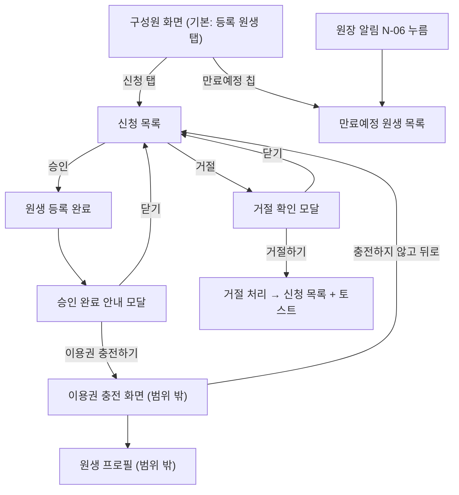

# [KD3-696] 구성원 관리 — 개발 기준 PRD

- 정리일: 2026-11-09 — 기획 문서 `[KD3-643] 충전 및 관리`(최종 편집 2026년 11월 2일 오후 6:21)에서 구성원 화면과 직접 이어진 내용만 가져와 Figma `V.4.0_원장-구성원`과 통합
- 기준 원본: Figma
- 문서 원본 보관: `./original/`
- Figma 캐시 보관: `./figma/`
- 구현 PR: 없음 (PR 생성 단계에서 번호를 추가한다)

## 이 문서를 읽는 법

| 표시 | 뜻 | 기록 위치 |
|---|---|---|
| 표시 없음 | 여러 원본이 같은 내용을 말한다 | - |
| `(PRD 단독)` | PDF·문서에만 있지만 명확하고 비충돌인 확정 요구사항 | 본문과 원본 위치 |
| `(Figma 단독)` | Figma에만 있지만 명확하고 비충돌인 확정 요구사항 | 본문과 Figma 위치 |
| `(DIFF-n)` | 문서와 Figma가 다르며 본문은 Figma를 따른다 | 9. PDF·문서와 Figma의 차이 |
| `(OQ-Pn)` | PDF·문서 내용 중 모호하거나 확인이 필요한 질문 | 10. Open Questions |
| `(OQ-Fn)` | Figma 내용 중 모호하거나 내부 확인이 필요한 질문 | 10. Open Questions |
| `(OQ-Cn)` | 클라이언트에서 확인할 내용 | 10. Open Questions |
| `(OQ-Sn)` | 서버에서 확인할 내용 | 10. Open Questions |
| `(내 추론)` | 원본에 없고 정리 과정에서 추론한 내용 | 본문과 필요 시 OQ |

- Figma 위치는 노드 ID(`30:12732` 형식)로 적는다. 화면 번호(`1a`, `2b` 등)는 Figma `Description`(`30:12658`)의 번호를 그대로 쓴다.
- 화면의 UI 문구는 Figma 시안 화면에 적힌 글자를 기준으로 한다. 시안과 `Description` 문구가 다른 9곳은 기획자 확인(2026-11-09)으로 정했고 `확정된 질문`의 OQ-F2에 적었다. 그래서 일부 문구는 시안이 아니라 `Description`을 따른다.

## 원본

| 원본 | 상태·편집일 | 원본 위치 | 보존 사본 |
|---|---|---|---|
| PRD (기획 문서) | 문서 상태 `최신`, 최종 편집 2026년 11월 2일 오후 6:21, 담당 `PM_서현` | `/Users/yunjeongchoi/Library/Mobile Documents/com~apple~CloudDocs/똑독/개인 페이지 & 공유된 페이지 14/[KD3-643] 충전 및 관리 4006c15f67fb80ebbd74f4426582b49f.md` | `./original/[KD3-643] 충전 및 관리 4006c15f67fb80ebbd74f4426582b49f.md` (원본 폴더 구조 그대로 `./original/[KD3-643] 충전 및 관리/`) |
| Figma 상위 섹션 | 섹션 `V.4.0_원장-구성원`(`30:12052`), Header `Version. 4.0` · `Date 2026.11.01` · `담당자 이서현` | `https://www.figma.com/design/LiCUY2CN6tvNXbHziPpoh6/%EB%98%91%EB%8F%85--Dev-?node-id=30-12052` | 구조 `./figma/LiCUY2CN6tvNXbHziPpoh6_30-12052.json`, 추출 글자 `./figma/texts.md`, 화면 이미지 `./figma/images/` (19장) |

- 기획 문서 머리말의 `지라 티켓`은 `KD3-636`이고 제목은 `[KD3-643]`이다. 이 PRD의 티켓 번호 `KD3-696`은 사용자가 지정했다.
- 기획 문서는 이용권 충전·삭제·홀딩·이력까지 다루는 큰 문서다. 이번 범위(구성원 관리)와 직접 이어진 부분만 가져왔고, 가져오지 않은 부분은 2.2에 적었다.
- Figma 섹션 안의 `설계번호 01`~`설계번호 18` 틀(44×32)은 글자가 번호 하나뿐인 표식이다. 이름에 `S-01`~`S-03`, `템플릿`이 들어 있어 이용권 등록 쪽 표식으로 보이며, 이 PRD에는 사용하지 않았다. (내 추론)
- Figma 호출은 이번 작업에서 2회였다(구조·글자 1회, 화면 이미지 1회).

## 1. 개요

출처: 기획 문서 1장, Figma `Description`(`30:12658`)

### 1.1 한 줄 요약

원장이 `구성원` 화면에서 `등록 원생`과 `신청`을 탭으로 나눠 보고, 등록 원생을 이용권 상태(`만료예정`·`만료`)로 걸러 보며, QR로 들어온 신청을 승인·거절하고, 승인 직후 바로 이용권 충전으로 이어갈 수 있게 한다.

### 1.2 목적

- 기존 `구성원` 화면의 상단 내비게이션을 바꾼다(`보호자 초대` 버튼 삭제, 제목 좌측 정렬, QR·알림 아이콘 추가). (Figma 단독)
- 목록 한 줄에서 원생의 이용권 상태를 바로 알 수 있게 한다. (Figma 단독)
- 승인 대기 목록을 별도 화면이 아니라 `신청` 탭으로 합친다. (Figma 단독, 기존 화면은 `30:13532`)
- 승인한 뒤 바로 이용권을 충전할 수 있게 한다(충전은 선택).

## 2. 범위

### 2.1 만드는 것

원장 앱 `구성원` 화면

- 상단 내비게이션(1a), `등록 원생`·`신청` 탭, 필터 칩, 원생 리스트(1b), 하단 내비게이션·검색(1c) (Figma 단독)
- 등록 원생 탭의 `만료예정`·`만료` 필터와 빈 상태(2a, 2b) (Figma 단독)
- 신청 탭의 인원 표시·정렬(3a, 3b), 승인 완료 안내 모달·거절 확인 모달(3c), 거절 완료 토스트(4c)
- 승인 후 이용권 충전 화면으로 이어지는 진입
- 원장 `이용권 만료 예정` 알림(N-06)을 눌렀을 때 `만료예정` 칩이 선택된 구성원 목록으로 이동 (PRD 단독, DIFF-3)

기획 문서에서 가져온 규칙

- QR 신청 승인 흐름: 3.2, FR-11, S-07
- 이용권 상태 정의 중 목록의 배지·필터 판정에 쓰는 부분(5장)
- 원장 알림 N-06

### 2.2 만들지 않는 것

| 제외 항목 | 이유 | 후속 위치 |
|---|---|---|
| 이용권 충전 화면(S-03)과 시작일·등록된 이용권 바텀시트, 충전 입력·검증 규칙(FR-02~FR-05) | 이번 범위는 충전 화면으로 들어가는 입구까지다. | 기획 문서 [KD3-643] 충전 |
| 원생 프로필(S-01), 이용권 목록(S-02), 이용권 상세(S-04), 삭제(S-05), 홀딩(S-06), 만료일 수정, 이용권 이력(FR-01·FR-06~FR-10) | 구성원 화면이 아닌 이용권 관리 기능이다. 목록에서 원생을 누르면 가는 상세 프로필 화면의 내용도 이 PRD에서 정하지 않는다. | 기획 문서 [KD3-643] 충전 |
| 보호자 대상 알림 N-01~N-05, N-07 | 이용권 충전·홀딩·연장 등 이용권 관리 기능의 알림이다. | 기획 문서 [KD3-643] 충전 |
| 이용권 템플릿 생성·수정·삭제 | 마이페이지 > 이용권 관리의 별도 기능이다. | 이용권 템플릿 PRD |
| 이용권 차감·반환(첫 등원 처리 포함), 사용할 이용권 선택 | 등원예약의 책임 범위다. | 등원예약 PRD (작성 필요) |
| QR 연결 신청 자체(신청·원생 등록 요청 생성) | 연결 신청 기능의 범위다. 이 문서는 신청 목록에서 승인·거절하는 부분만 다룬다. | QR 연결 신청 PRD |
| 퇴원·연동 해제 | 퇴원 기능의 범위다. | 퇴원·연동 해제 PRD |
| 인앱 결제·환불 | v4.0은 앱 밖에서 결제하고 원장이 수동으로 충전한다. | v4.0 이후 |
| Figma `기존 구성원 화면`(`30:13426`), `기존 승인대기 화면`(`30:13532`) | 변경 전 화면을 비교하려고 둔 것이다. 구현 대상이 아니다. | - |

## 3. 사용자 흐름

출처: 기획 문서 3.2, Figma `Description` 3c·4c, 화면 `30:12053`·`30:12205`·`30:12507`

- 승인하면 바로 원생 등록이 완료된다. 승인 완료 안내 모달에서 닫기를 누르면 충전 없이 등록만 유지되고, 이후 원생 프로필에서 충전할 수 있다.
- 충전하면 해당 원생의 원생 프로필로 이동해 토스트 `이용권을 충전했어요`를 표시한다. (PRD 단독, 충전 이후 동작은 범위 밖)
- 충전 화면에서 충전하지 않고 나가도 원생 등록은 취소되지 않는다. 충전하지 않고 뒤로 가면 이전 화면인 `신청` 탭 목록으로 돌아간다. 방금 승인한 원생은 이미 목록에서 빠져 있다.
- 승인된 원생은 신청 목록에서 빠지고 등록 원생 목록에 반영된다. 거절한 원생도 신청 목록에서 빠진다. 신청 인원과 `신청` 탭 배지 숫자가 같이 바뀐다.
- 승인 대기 목록으로 가던 기존 진입점(구성원 화면 위쪽 `연결 승인` 버튼, 홈, 알림)은 모두 구성원 화면의 `신청` 탭을 열도록 바꾼다. 기존 `승인 대기 목록` 화면(`/owner/members/approval`)은 없앤다. 구성원 위쪽 `연결 승인` 버튼은 1a의 상단 내비게이션 변경으로 함께 사라진다.

## 4. 공통 정책

출처: Figma `Description` 4c, 기획 문서 7.1, 프로젝트 공통 정책 `docs/policy/loading-validation-error.md`

- 거절 요청이 실패하면 신청 목록을 그대로 두고 공통 오류 안내를 보여준다. (Figma 단독)
- 로딩·중복 요청·조회 실패·입력 검사는 프로젝트 공통 정책 문서를 따른다. 기획 문서 7.1도 같은 방향이다(목록 조회 실패는 공통 네트워크 오류 화면, 액션 실패는 액션 실패 기준, 중복 요청 차단). (PRD 단독)
- 토스트는 공통 토스트 노출 시간에 따라 자동으로 사라진다. (Figma 단독)

## 5. 상태

### 5.1 화면 상태

출처: Figma `Description` 2b·3a·4c, 시안 `30:12899`·`30:12787`·`30:12843`·`30:12930`·`30:13286`·`30:13356`, 프로젝트 공통 정책 `docs/policy/loading-validation-error.md`

대상 화면은 구성원 화면의 `등록 원생` 탭과 `신청` 탭이다. 승인 완료 안내 모달과 거절 확인 모달은 요청이 끝난 뒤·실행 전에 뜨는 것이라 따로 로딩 상태가 없다.

| 상태 | 등록 원생 탭 | 신청 탭 | 출처 |
|---|---|---|---|
| 로딩 | 목록 조회 중에는 Header와 하단 내비게이션을 유지하고 콘텐츠 영역에 Spinner를 보여준다. | 같음 | 공통 정책 (내 추론: 구성원 화면에 적용) |
| 조회 실패 | 콘텐츠 영역을 `PageError`로 바꾼다. 제목 `정보를 불러오지 못했어요`, 설명 `잠시 후 다시 시도해 주세요.`, 버튼 `다시 시도하기`. 다시 시도 중에는 중복 클릭을 막는다. | 같음 | 공통 정책 (내 추론: 구성원 화면에 적용) |
| 빈 상태 | 등록 원생 0명: `등록된 원생이 없어요` / `보호자를 연결하고 유치원을 운영해 보세요.` (칩 숨김). `만료예정`·`만료` 결과 없음, 검색 결과 없음은 7장 2b·1c | 신청 0명: `신청된 원생이 없어요` / `QR코드를 통해 원생 신청을 받아보세요.`. 검색 결과 없음은 7장 1c | Figma 단독 |
| 액션 진행 중 | - | 승인·거절 요청 중에는 같은 요청을 막는다(버튼 비활성화). | 공통 정책 (내 추론) |
| 액션 실패 | - | 거절 실패: 목록을 유지하고 공통 오류 안내를 보여준다. 승인 실패도 같은 기준으로 현재 화면을 유지하고 버튼을 다시 활성화한다. | 거절은 Figma 단독(4c), 승인은 공통 정책 (내 추론) |
| 이미 처리된 신청 | - | 신청자가 취소했거나 다른 기기에서 이미 처리된 신청을 승인·거절하면 토스트 `취소된 연결 신청이에요`를 보여주고 신청 목록을 새로 불러온다(기존 동작 유지). 이때 승인 완료 모달은 띄우지 않는다. | 사용자 확정(2026-11-09, 기존 코드 동작) |
| 찾지 못함 | 구성원 목록 화면 자체가 없어지는 경우는 없다. 알림(N-06)으로 들어와도 목록이 열린다. | 같음 | (내 추론) |

### 5.2 이용권 상태

출처: 기획 문서 5장 `이용권 상태 정의`

목록의 배지와 `만료예정`·`만료` 필터를 판정하는 데 쓰는 이용권 상태다. (PRD 단독)

| 상태 | 정의 | 다음 상태 |
|---|---|---|
| 사용 예정 | 시작일이 아직 오지 않은 이용권 | 시작일이 되면 사용 중 |
| 사용 중 | 시작일이 지났고, 잔여 횟수가 1 이상이며, 만료일 전(또는 만료 없음) | 홀딩 중 / 만료 |
| 홀딩 중 | 원장이 지정한 기간 동안 사용이 멈춘 이용권. 만료일 카운트가 멈추고 잔여 횟수는 유지 | 예정 종료일 다음 날 또는 조기 취소 당일 사용 중 |
| 만료 | 잔여 횟수가 0이 됐거나, 만료일이 지남(잔여 횟수가 남아 있어도 전환) | 없음. 다시 쓰려면 새로 충전 |

- 잔여 횟수를 다 쓴 이용권도 `만료`로 표시한다. 기획 문서 11월 2일 변경으로 `소진`을 없애고 `만료`로 통일했다. (DIFF-2)
- 한 원생이 이용권을 여러 개 가질 수 있다. (PRD 단독)

## 6. 데이터 항목

출처: Figma `Description` 1b·2a, 화면 `30:12732`·`30:12761`·`30:12961`, `CASE 정리`(`30:13492`)

### 6.1 등록 원생 목록 한 줄 (Figma 단독)

| 항목 | 표시 | 조건 |
|---|---|---|
| 프로필 이미지 | 원생 프로필 이미지 | 항상 |
| 원생 이름 | 이름 | 항상 |
| 성별 | 성별 아이콘 (`gender`) | 항상 |
| 보호자 | `{보호자 이름} 보호자 · {보호자 연락처}` (예: `김지원 보호자 · 010-0000-0000`). 연락처 `guardianPhoneNumber`는 서버가 하이픈 포함 형식 그대로 준다. 값이 `null`이면 `{보호자 이름} 보호자 · 연락처 없음`으로 보여준다 | 항상 |
| 상태 배지 | `1회 남음` / `D-n` / `만료` | 아래 6.2 |
| 이용권 정보 영역 | 이용권명과 잔여 횟수·잔여 기간 한 줄. 형식 `20회권.. \| 1회·90일 남음` | 서버가 준 `ticket`이 있을 때. `ticket`이 `null`이면(이용권 없음·모두 만료) 숨김 |

- 목록 한 줄에 보여줄 이용권(대표 이용권)은 서버가 응답의 `ticket`으로 준다. 서버는 만료 안 된 이용권 중 가장 최근에 충전한 것을 준다. 앱이 대표 이용권을 직접 고르지 않는다. `홀딩 중`·`사용 예정` 이용권이 대표일 때도 서버 값을 그대로 보여준다.
  - `ticket`은 `ticketId`·`name`·`status`·`remainingCount`·`chargeCount`·`expiresOn`·`daysLeft`로 온다. 이용권 정보 영역의 잔여 횟수·잔여 기간은 이 값을 쓴다. 만료일이 없는 이용권(`expiresOn`·`daysLeft`가 `null`)은 남은 횟수만 보여준다(예: `20회권 | 1회 남음`).
  - `ticketState`가 `NONE`(이용권 없음)이거나 `EXPIRED`(모두 만료)면 `ticket`은 `null`이다.
- 이용권 이름이 10자를 넘으면 말줄임표(`...`)로 줄인다.
- 이용권 미보유 원생은 이용권 관련 영역(배지·정보)을 숨긴다. (`CASE 정리`: `이용권 보유 X (처음부터 지급X)`)
- 만료된 원생은 이름·성별·보호자 이름·연락처를 그대로 보여주고, `만료` 배지만 붙인다. 이용권 이름·잔여 정보 영역은 표시하지 않는다.
- 목록의 항목을 누르면 해당 원생의 상세 프로필 화면으로 이동한다.

### 6.2 `만료예정`·`만료` 판정 (Figma 단독)

| 구분 | 조건 | 배지 |
|---|---|---|
| 만료예정 | 아래 중 하나 이상 충족: 이용권 잔여 횟수가 1회 / 이용권 잔여 기간이 3일 이하 | 잔여 1회: `1회 남음`, 잔여 기간 3일 이하: `D-n` |
| 만료예정 (두 조건 모두) | 잔여 1회이고 잔여 기간도 3일 이하 | `D-n`만 표시 |
| 만료 | 가지고 있는 이용권이 모두 만료 또는 소진 | `만료` |

- 판정은 서버가 하고 응답의 `ticketState`(`NONE`·`VALID`·`EXPIRING`·`EXPIRED`)와 `expiringReason`(`REMAINING_ONE`·`DAYS_LEFT`)으로 온다. `EXPIRING`이면 `만료예정`, `EXPIRED`이면 `만료`다. 배지는 `REMAINING_ONE`이면 `1회 남음`, `DAYS_LEFT`이면 `D-n`(`ticket.daysLeft`)이다. 두 조건이 모두 해당하면 서버가 `DAYS_LEFT`만 준다.
- 만료일 당일(잔여 기간 0일)은 배지 `D-0`으로 보여주고 `만료예정`에 속한다. 만료일이 지난 다음 날부터 `만료`다. 잔여 기간 1~3일은 `D-1`~`D-3`이다.
- `만료` 배지의 이용권 만료 정의는 5장을 따른다. (DIFF-2)

### 6.3 신청 목록 한 줄 (Figma 단독)

- 프로필 이미지, 강아지 이름, 성별 아이콘, `{보호자 이름} 보호자`, 오른쪽에 `거절`·`승인` 버튼. (`30:12988`)
- 신청 목록 정렬 기준은 `최신순`(기본) / `이름순` / `오래된순`이다. 정렬은 서버가 `sort=LATEST|NAME|OLDEST`로 처리하고(기본 `LATEST`, 이름순은 한글 우선), 응답에 신청 일시는 없으며 앱이 직접 정렬하지 않는다.

## 7. 화면 명세

Figma 순서와 번호를 따른다. 출처는 Figma `Description`(`30:12658`)이고, 괄호 안은 해당 시안 노드다.

### 1a. 상단 내비게이션 변경 (Figma 단독, `30:12732` 외 구성원 화면 공통)

- 기존 상단 내비게이션의 `보호자 초대` 버튼을 삭제한다.
- 상단 타이틀 `구성원`을 좌측 정렬로 바꾼다.
- 오른쪽에 QR코드 아이콘과 알림 아이콘을 추가한다.
- QR코드 아이콘을 누르면 기존 `보호자 초대` 시트(QR 보기·QR 저장·링크 공유)를 그대로 연다. 새 화면을 만들지 않으며, 링크 공유 기능도 이 시트에 그대로 남는다.
- 알림 아이콘을 누르면 알림 화면으로 이동한다. 읽지 않은 알림이 있으면 알림 아이콘에 상태 표시를 한다.

### 1b. 탭·필터 및 원생 리스트 (Figma 단독, `30:12732`·`30:12761`)

- 탭: 기존 구성원 목록을 `등록 원생`과 `신청` 2개 탭으로 나눈다. `등록 원생`이 기본 선택이고, 선택한 탭은 활성 상태로 표시한다.
- `신청` 탭에는 처리 대기 중인 신청 건수를 배지로 표시한다. 0건이면 배지를 숨긴다. 신청 건수는 서버의 `pendingCount`(검색과 무관한 전체 신청 수, `/members`·`/pending` 둘 다 내려줌)를 쓴다.
- 필터 칩: 등록 원생 탭의 필터는 `전체` / `만료예정` / `만료`이다. `전체`가 기본 선택이고, 칩을 고르면 조건에 맞는 원생만 보여준다. 다른 칩을 고르면 기존 선택이 풀린다.
- 시안의 칩 글자는 `전체 22`, `만료예정 2`, `만료 3`처럼 개수를 함께 보여준다. 개수는 서버의 `counts`(`all`·`expiring`·`expired`)를 쓴다. `counts`는 검색어·선택한 칩과 무관한 유치원 전체 기준이다. 칩을 고르면 `filter=ALL|EXPIRING|EXPIRED`로 서버가 거른다.
- 원생 리스트의 한 줄 구성은 6.1을 따른다.
- 등록 원생 탭에는 정렬 영역을 만들지 않는다(시안에 없음). 서버가 주는 순서 그대로 보여준다. 필터 칩·검색을 적용해도 받은 순서를 유지한다. 서버는 신청(등록) 시각 최신순으로 준다.

### 1c. 하단 내비게이션 및 검색 (Figma 단독, `30:12930`·`30:13356`)

- 하단 내비게이션 아이콘을 변경된 V4 디자인 시스템 기준으로 바꾼다. `홈` / `일과` / `앨범` / `구성원` / `마이` 구성은 유지하고, `구성원` 탭을 활성으로 표시한다.
- 검색: 검색창으로 원생 이름 또는 견종을 검색한다. 플레이스홀더는 `이름 혹은 견종을 입력해 주세요`이다. 서버가 `keyword`로 원생 이름·견종을 검색하며, 보호자 이름으로는 검색하지 않는다. 견종은 응답의 `breed`에 온다.
- 검색어와 일치하는 원생 목록을 보여준다. 결과가 없으면 제목 `검색된 원생이 없어요`, 본문 `다른 원생을 검색해보세요.`를 보여준다.
- 검색어를 지우면 현재 선택된 탭과 필터 조건에 맞는 목록으로 돌아간다. 검색 결과가 없는 상태에서도 검색창과 탭 메뉴는 유지한다.

### 2a. `만료예정`·`만료` 필터 (Figma 단독, `30:12761`·`30:12961`)

- `만료예정` 칩을 고르면 이용권 만료가 임박한 원생만 보여준다. 판정은 6.2를 따른다.
- `만료` 칩을 고르면 이용권이 만료된 원생 목록을 보여준다. 표시 방식은 6.1을 따른다.
- 조건에 맞는 원생이 없으면 각 필터의 빈 상태를 보여준다(2b).

### 2b. 등록 원생 없음 및 필터 결과 없음 (Figma 단독, `30:12899`·`30:12787`·`30:12843`)

- 등록 원생이 0명이면 목록 대신 빈 상태 화면을 보여주고 필터 칩을 모두 숨긴다. 제목 `등록된 원생이 없어요`, 본문 `보호자를 연결하고 유치원을 운영해 보세요.`
- 원생이 있는데 필터 결과가 없으면 칩은 유지하고 리스트 영역에 안내 문구를 보여준다.
  - `만료예정`: 제목 `만료 예정인 원생이 없어요`, 본문 `다른 상태의 원생을 확인해 보세요.`
  - `만료`: 제목 `이용권이 만료된 원생이 없어요`, 본문 `다른 상태의 원생을 확인해 보세요.`
- 다른 칩을 고르면 해당 조건의 목록으로 바뀐다. 빈 상태에서도 상단 검색창과 탭 메뉴는 유지한다.
- 등록 원생이 추가되면 빈 상태를 풀고 목록과 필터 칩을 보여준다.

### 3a. 신청 인원 표시 (Figma 단독, `30:12988`·`30:13137`·`30:13286`)

- `신청` 탭을 선택하면 승인 대기 중인 원생 목록을 보여준다.
- 신청 인원이 1명 이상이면 목록 위에 신청 강아지 수를 나타내는 태그를 보여준다(시안: `강아지수 5`). 신청 인원이 0명이면 태그를 숨긴다. 인원에 따라 숫자가 자동으로 바뀐다. 태그는 목록 위 왼쪽 정렬로 배치한다.
- 신청 목록이 없으면 제목 `신청된 원생이 없어요`, 본문 `QR코드를 통해 원생 신청을 받아보세요.`를 보여준다.
- 승인 또는 거절이 끝나면 신청 인원과 목록을 새로 반영한다.

### 3b. 신청 목록 정렬 (Figma 단독, `30:12357`)

- 정렬 기준은 `최신순`(기본) / `이름순` / `오래된순`이다.
- 정렬 영역을 누르면 드롭다운이 열리고, 현재 선택된 옵션은 활성으로 표시한다. 옵션을 고르면 목록을 다시 정렬하고 드롭다운을 닫는다.
- `최신순`은 신청 일시가 최근인 순서, `이름순`은 원생 이름 오름차순, `오래된순`은 신청 일시가 오래된 순서이다.
- 정렬 기준을 바꿔도 신청 상태와 인원수는 유지한다. 정렬은 요청의 `sort` 값으로 서버가 처리한다.

### 3c. 승인 완료 안내 모달 / 거절 확인 모달 (`30:12053`, `30:12205`)

승인 완료 안내 모달

- 원생 승인이 끝나면 결과 안내형 모달을 보여준다.
- 제목 `원생 승인을 완료했어요`, 본문 `{강아지 이름}의 유치원 연결이 완료됐어요.`, 버튼 `닫기`(Secondary)·`이용권 충전하기`(Primary). (DIFF-1)
- `닫기`를 누르면 모달을 닫고 신청 목록으로 돌아간다.
- `이용권 충전하기`를 누르면 승인한 원생을 대상으로 이용권 충전 화면을 연다. 이동할 때는 승인한 신청 항목의 `petId`를 넘긴다. 승인 응답에는 id가 없다.
- 충전 여부와 관계없이 원생 등록 상태는 유지된다. 승인된 원생은 신청 목록에서 빠지고 등록 원생 목록에 반영된다.
- 승인으로 원생 등록이 끝난 직후에 모달을 띄운다. (기획 문서 S-07과 `Description` 3c가 같은 내용)

거절 확인 모달

- 신청 목록의 `거절` 버튼을 누르면 확인형 모달을 보여주고 배경을 어둡게 한다. (Figma 단독)
- 제목 `원생 승인을 거절할까요?`, 본문 `거절한 원생은 되돌릴 수 없어요.`, 버튼 `닫기`·`거절하기`.
- 닫는 버튼을 누르면 모달을 닫고 기존 신청 목록을 유지한다. `거절하기`를 누르면 해당 신청을 거절 처리한다.
- 거절이 끝나면 그 원생은 신청 목록에서 빠지고, 신청 인원과 탭 배지 숫자가 바뀐다.
- 모달 유형 구분: 안내형 모달은 이미 끝난 작업의 결과를 알리고 후속 행동을 제공한다. 확인형 모달은 되돌리기 어려운 작업을 실행하기 전에 의사를 다시 확인한다. 두 모달은 제목·설명·버튼 구성과 시각적 위계를 다르게 한다.

### 4c. 신청 거절 완료 토스트 (Figma 단독, `30:12507`)

- 거절 확인 모달에서 최종 거절을 선택하면 신청을 거절 처리하고 모달을 닫는다.
- 신청 목록 화면에 토스트 `원생 거절이 완료되었어요`를 보여준다.
- 거절한 원생은 목록에서 빠지고 신청 인원 태그와 탭 배지 숫자가 바뀐다.
- 거절 뒤 신청 인원이 0명이면 신청 목록 빈 상태 화면을 보여준다.
- 거절 요청이 실패하면 목록을 유지하고 공통 오류 안내를 보여준다.

## 8. 알림

출처: 기획 문서 6장 N-06

| ID | 트리거 | 수신자 | 알림 문구 | 이동·채널 |
|---|---|---|---|---|
| N-06 | 사용 중인 이용권의 만료 3일 전, 1일 전 오전 9시(잔여 1회 이상일 때만). 같은 날 여러 마리면 1건으로 묶음 | 원장 | 제목 `이용권 만료 예정` / 본문 `{원생 이름}의 이용권이 {M월 D일}에 만료돼요.` 묶음일 때: 제목 `이용권 만료 예정` / 본문 `{원생 이름} 외 {n}마리의 이용권이 3일 안에 만료돼요.` | 구성원 > 등록 원생 > `만료예정` 칩이 선택된 목록 · 푸시 O / 알림함 O (DIFF-3, DIFF-4) |

- N-06은 (PRD 단독)이다. 알림 발송은 서버가 한다. 앱은 알림을 눌렀을 때 구성원 목록으로 보내는 부분만 맡는다. (내 추론, 11장 참고)
- 이용권 삭제·충전·홀딩·연장 알림은 이 범위가 아니다(2.2).

## 9. PDF·문서와 Figma의 차이

### 확인이 필요한 차이

없음. 아래 차이는 Figma 우선 규칙으로 본문 기준이 정해졌다.

### 확정된 차이

펼쳐 보기

| ID | 항목 | PDF·문서 원문 | Figma 원문·본문 기준 | 확정 기준 | 본문 위치 |
|---|---|---|---|---|---|
| DIFF-1 | 승인 완료 안내 모달 문구 | S-07: 본문 `{강아지 이름}의 유치원 연결이 완료됐어요.`, 버튼 `닫기 · 이용권 충전` | 시안 `30:12053`: 본문 `{강아지 이름}의 유치원 연결이 완료됐어요`, 버튼 `닫기`·`이용권 충전하기` | Figma 시안을 따른다. 버튼 `이용권 충전하기`는 기획자 확인(2026-11-09)으로 시안이 맞다고 확정했다. 본문 끝 마침표는 기획자 확인으로 `Description`을 따른다(OQ-F2). | 7장 3c |
| DIFF-2 | `소진` 용어와 만료 정의 | 이용권 상태에서 `소진`을 없애고 `만료`로 통일(잔여 횟수를 다 쓴 이용권도 만료). 5장 만료: `잔여 횟수가 0이 됐거나, 만료일이 지남` | `Description` 2a: `가지고 있는 이용권이 모두 만료 또는 소진인 경우` | 뜻은 같고 `소진`이 옛 용어다. 만료 정의는 문서 5장을 따르고 화면 문구에는 `만료`만 쓴다. | 5장, 6.2 |
| DIFF-3 | 원장 만료 예정 알림 이동처 | N-06 이동: `원생 프로필 > 구성원(만료예정)` | 구성원 화면 `등록 원생` 탭의 `만료예정` 칩 (`30:12761`) | 구성원 > 등록 원생 > `만료예정` 칩이 선택된 목록으로 이동한다. 기존 코드도 `/owner/members?filter=expiring`으로 보낸다. | 8장 |
| DIFF-4 | `만료예정` 대상 범위 | N-05·N-06: 사용 중 이용권의 만료 3일 전·1일 전 오전 9시, 잔여 1회 이상일 때만 알림 | `Description` 2a: 잔여 횟수 1회이거나 잔여 기간 3일 이하이면 `만료예정` | 두 기능의 기준을 각각 그대로 따른다. 알림 대상은 문서 기준, 칩의 목록은 Figma 기준이다. 알림을 누르면 알림 대상이 아닌 원생도 목록에 함께 보일 수 있다. | 6.2, 8장 |
| DIFF-5 | 신청 목록의 이름 | 3.2 `구성원 > QR 신청`, 2.1 `신청` > `QR 신청` | 구성원 화면의 탭 이름 `신청` | 화면에서는 `신청` 탭이라고만 쓴다. | 3장, 7장 |

## 10. Open Questions

### PDF·문서에서 확인이 필요한 내용

없음

### Figma에서 확인이 필요한 내용

없음

### 클라이언트에 확인할 내용

없음

### 서버에 확인할 내용

없음. 백엔드에 보낸 질문과 답변은 `./notes/backend-questions.md`에 있다.

### 확정된 질문

펼쳐 보기

| ID | 확정일 | 사용자 답변 | 확정 기준 | 본문 위치 |
|---|---|---|---|---|
| OQ-P1 | 2026-11-09 | 신청 탭 목록 | 충전 화면에서 충전하지 않고 뒤로 가면 이전 화면인 `신청` 탭 목록으로 돌아간다. 등록은 유지된다. | 3장 |
| OQ-F1 | 2026-11-09 | 기존 초대 시트 그대로 | QR코드 아이콘은 기존 `보호자 초대` 시트(QR 보기·QR 저장·링크 공유)를 그대로 연다. 새 화면은 만들지 않는다. | 7장 1a |
| OQ-F3 | 2026-11-09 | 서버가 준 대표 이용권을 그대로 보여준다 (`사용 중` 우선 규칙은 취소) | 같은 날 처음에는 `사용 중` 이용권 중 가장 최근 것을 보여주는 규칙(B안)으로 확정했으나, 근거가 원본에 없고(Figma `Description` `30:12674`: "이용권 정보는 가장 최근에 충전된 이용권 표시") 서버가 "만료 안 된 이용권 중 가장 최근 충전"을 주는 것으로 답해서 취소했다. 새 기준: 서버가 준 `ticket`을 그대로 쓰고, `홀딩 중`·`사용 예정`이 대표일 때도 서버 값을 따른다. | 6.1, 6.2 |
| OQ-F4 | 2026-11-09 | D-0, 만료예정 | 만료일 당일은 `D-0` 배지로 `만료예정`에 들어간다. 만료일이 지나면 `만료`. | 6.2 |
| OQ-F5 | 2026-11-09 | 서버가 주는 순서 | 등록 원생 탭은 정렬 UI 없이 서버가 주는 순서 그대로 보여준다. 서버는 신청(등록) 시각 최신순으로 준다(OQ-S4로 확인). | 7장 1b |
| OQ-C1 | 2026-11-09 | 모두 구성원 신청 탭으로 | 홈·알림·구성원 `연결 승인` 진입점은 모두 구성원 화면 `신청` 탭으로 가고, 기존 `승인 대기 목록` 화면은 없앤다. | 3장 |
| OQ-C2 | 2026-11-09 | 기존 동작 유지 | 이미 취소·처리된 신청을 승인·거절하면 토스트 `취소된 연결 신청이에요`를 보여주고 목록을 새로 불러온다. | 5.1 |
| OQ-F2 | 2026-11-09 | 기획자 확인(사용자가 전달). 항목별로 어느 쪽을 따를지 표시해 줌 | 시안과 `Description`이 다른 9곳의 기준을 아래처럼 정했다. 1 승인 완료 모달 버튼: 시안 `이용권 충전하기` / 2 승인 완료 모달 본문 끝: `Description` `{강아지 이름}의 유치원 연결이 완료됐어요.` / 3 거절 모달 본문: `Description` `거절한 원생은 되돌릴 수 없어요.`(시안의 `되돌릴수` 띄어쓰기를 고침) / 4 거절 모달 버튼: 시안 `닫기`·`거절하기` / 5 거절 완료 토스트: 시안 `원생 거절이 완료되었어요` / 6 필터 칩: 시안 `만료예정` / 7 `만료` 필터 빈 상태 제목: `이용권이 만료된 원생이 없어요`(이미지에 박스가 없고 "기타(변경시안 참고)"라고만 적혀 있어, 시안 `만료된 원생이 없어요`·`Description` `만료된 이용권이 없어요`가 아니라 사용자가 정한 문구를 쓴다) / 8 신청 빈 상태 본문 끝: `Description` `QR코드를 통해 원생 신청을 받아보세요.` / 9 신청 인원 태그 위치: 시안 왼쪽 정렬. `만료` 칩 개수는 서버 `counts`가 세 칩 모두 주므로 모든 칩에 개수를 보여준다(OQ-S2). | 5.1, 7장 2b·3a·3c |
| OQ-F6 | 2026-11-09 | 대신 안내 문구를 표시 | 백엔드 답변으로 생긴 질문이다(보호자 연락처 `guardianPhoneNumber`는 값이 없으면 `null`). 연락처가 `null`이면 `{보호자 이름} 보호자 · 연락처 없음`으로 보여준다. `연락처 없음`은 Figma에 없는 문구라서 사용자가 정했다. | 6.1 |
| OQ-F7 | 2026-11-09 | 남은 횟수만 표시 | 테스트 목록 단계에서 발견한 질문이다. 만료일이 없는 이용권(`expiresOn`·`daysLeft`가 `null`)은 이용권 정보 영역에 남은 횟수만 보여준다(예: `20회권 \| 1회 남음`). | 6.1 |
| OQ-S1 | 2026-11-09 | 사용자 답변 없음. 백엔드 답변 | 두 응답(`/members`, `/pending`)에 `gender`가 있다. 보호자 연락처 `guardianPhoneNumber`는 등록 원생 목록(`/members`)에만 있고, 하이픈 포함 `010-1234-5678` 형식 그대로 오며 값이 없으면 `null`이다. | 6.1 |
| OQ-S2 | 2026-11-09 | 사용자 답변 없음. 백엔드 답변 | `/members` 항목마다 `ticketState`(`NONE`/`VALID`/`EXPIRING`/`EXPIRED`), `expiringReason`(`REMAINING_ONE`/`DAYS_LEFT`), `ticket`(`ticketId`·`name`·`status`·`remainingCount`·`chargeCount`·`expiresOn`·`daysLeft`)이 온다. `NONE`·`EXPIRED`이면 `ticket`은 `null`이다. 칩 개수는 `counts`(`all`·`expiring`·`expired`), 필터는 `filter=ALL\|EXPIRING\|EXPIRED`로 서버가 처리하고, `counts`는 검색어·칩과 무관한 유치원 전체 기준이다. | 6.1, 6.2, 7장 1b |
| OQ-S3 | 2026-11-09 | 사용자 답변 없음. 백엔드 답변 | 응답에 `breed`가 있고, `keyword`는 원생 이름·견종으로 검색한다. 보호자 이름으로는 검색하지 않는다. | 7장 1c |
| OQ-S4 | 2026-11-09 | 사용자 답변 없음. Swagger·백엔드 코드로 확인 | 등록 원생 목록은 서버가 신청(등록) 시각 최신순으로 주고 검색해도 같다. 칩 개수·필터는 처음 "클라이언트가 계산"으로 확정했지만 2026-11-09 백엔드가 `counts`와 `filter`를 추가해 서버 값을 쓰는 것으로 바뀌었다(OQ-S2). | 7장 1b |
| OQ-S5 | 2026-11-09 | 사용자 답변 없음. 백엔드 답변 | `/pending`에 `sort=LATEST\|NAME\|OLDEST`가 있다. 기본은 `LATEST`(최신순)이고 이름순은 한글 우선이며, 정렬은 서버가 한다. 응답에 신청 일시 필드는 없다. 신청 탭 배지용 `pendingCount`는 `/members`·`/pending` 둘 다 오며 검색과 무관한 전체 신청 수다. | 6.3, 7장 1b, 7장 3b |
| OQ-S6 | 2026-11-09 | 사용자 답변 없음. Swagger·백엔드 코드로 확인 | 승인·거절 응답은 본문이 없다(`ResponseVoid`). 승인 요청의 `memberId`는 신청 목록 항목의 `memberId`다. 이용권 API는 `petId` 기준(미병합)이고 신청 목록 항목에 `petId`가 있어서, 승인 직후 충전 화면에는 그 신청 항목의 `petId`를 넘긴다. | 7장 3c |

## 11. 구현할 때 놓치기 쉬운 점

이 장은 원본 요구사항이 아니라 코드베이스를 확인하며 남긴 구현 메모다. 확인일은 2026-11-09, 경로는 저장소 루트 기준이다.

- **기존 구성원 화면 구조가 많이 다르다.** `apps/knockdog/src/views/owner-members-page/ui/OwnerMembersPage.tsx:9-59`는 주황 그라데이션 Hero(검색창·`연결 승인` 버튼·알림 벨) + 요약줄(`전체 원생 n`, 정렬 드롭다운) + 목록 + 초대 버튼 구조다. Figma는 탭 2개·필터 칩·QR 아이콘·좌측 정렬 타이틀로 바뀐다.
- **승인은 지금 별도 화면이다.** `apps/knockdog/src/views/owner-members-approval-page/ui/OwnerMembersApprovalPage.tsx`(타이틀 `승인 대기 목록`, `승인대기 n건`)이고, 승인 성공 시 모달이 아니라 토스트 `{강아지 이름}의 유치원 연결이 완료됐어요`를 보여준다(143-153줄). 거절 토스트도 `{강아지 이름}의 연결 신청을 거절했어요`로 Figma와 다르다. 이 화면은 `신청` 탭으로 합치고 없앤다. (3장)
- **카드 재사용.** `apps/knockdog/src/features/owner-members/ui/OwnerMemberCard.tsx`는 `rightAddon`으로 승인·거절 버튼을 붙이는 구조다. 성별 아이콘·연락처·배지·이용권 영역은 없어서 확장해야 한다. 재사용으로 부족하면 만들기 전에 이유를 알리고 선택을 받는다(사용자 지침).
- **만료 판정 로직이 이미 있다.** `apps/knockdog/src/entities/owner-member/model/ownerMemberTicket.ts:48-71`의 `isUsageExpired`는 잔여 0 이하 또는 만료일이 오늘보다 앞이면 만료로 본다. 문서 5장의 만료 정의와 같고, 남은 일수(`remainingDays`)도 계산한다. 테스트는 `ownerMemberTicket.test.ts`에 있다.
- **알림에서 `filter=expiring`으로 오지만 받는 곳이 없다.** `apps/knockdog/src/views/notification-inbox-page/model/useNotificationInboxDeepLink.ts:118-121`이 `navigateToTab('/owner/members', { filter: 'expiring', source: 'inbox' })`로 보내는데, 구성원 화면(`useOwnerMembersPage.ts`)은 이 값을 읽지 않는다. `만료예정` 칩이 선택된 채 열리게 만들어야 한다. (DIFF-3)
- **알림 아이콘은 이미 있다.** `OwnerMembersHero.tsx`가 `NotificationBell`과 `useHasUnreadNotificationQuery`(원장용)를 쓴다. 위치만 Figma에 맞춘다.
- **QR 코드는 초대 시트에 있다.** `apps/knockdog/src/views/owner-members-page/ui/OwnerMembersInviteSheet.tsx`가 `QRCodeSVG`와 `QR 저장`을 쓴다. QR 아이콘이 이 시트를 그대로 연다. (7장 1a)
- **이용권 충전 화면은 화면만 있고 서버와 연결돼 있지 않다.** `apps/knockdog/src/views/owner/member-ticket-charge/ui/MemberTicketChargePage.tsx`(경로 `/owner/members/[id]/ticket-charge`)는 대상 원생 값(`[id]`)을 읽지 않는다. 제출 처리(164-183줄)도 서버 요청 없이 `send(true)` 또는 성공 토스트를 보여주고 뒤로 간다(2026-11-09 확인). 승인 직후 이 화면으로 올바른 원생을 넘기는 일은 충전 쪽 구현과 함께 정해야 한다. 넘길 값은 신청 항목의 `petId`다. (7장 3c)
- **승인·거절 뒤 목록 갱신은 이미 된다.** `apps/knockdog/src/entities/owner-member/api/useOwnerMemberMutation.ts:37-41`이 신청 목록과 등록 원생 목록을 함께 무효화한다. 신청 인원·탭 배지·등록 원생 반영 요구와 맞는다.
- **중복 요청 차단.** `OwnerMembersApprovalPage.tsx:101`에서 승인·거절 진행 중에는 두 버튼을 모두 비활성화한다. 모달로 옮길 때도 유지한다.
- **이미 취소된 신청.** 기존 코드는 이 경우 토스트 `취소된 연결 신청이에요`를 보여준다(`OwnerMembersApprovalPage.tsx:21-23`, 126-129). Figma에는 이 상태의 시안이 없어서 기존 동작을 유지하기로 했다(5.1). 실패 시에는 Figma가 `공통 오류 안내`를 말하고, 공통 문구 상수는 `apps/knockdog/src/shared/ui/toast/config/messages.ts`의 `COMMON_ERROR_TOAST_MESSAGE`(`일시적 오류로 요청을 완료하지 못했어요`)다. 기존 승인·거절 실패 문구(`연결 신청 승인에 실패했어요` 등)와 다르다. (내 추론)
- **검색 입력 제한이 이미 있다.** `apps/knockdog/src/views/owner-members-page/model/useOwnerMembersPage.ts:17,78-82`는 한글·영문·공백만 허용하고 20자로 자른다. 현재 앱은 강아지명·보호자명으로 검색하지만 Figma와 서버(`keyword`)는 원생 이름·견종이다(OQ-S3 백엔드 답변).
- **기존 정렬.** 현재 구성원 화면에는 `이름순`·`최근 등원일순` 정렬이 있다(`apps/knockdog/src/views/owner-members-page/config/ownerMembersContent.ts`). Figma 등록 원생 탭에는 없으므로 정렬 UI는 없앤다. (7장 1b)
- **웹과 앱이 같이 처리하는 부분.** 뒤로가기(헤더 버튼·Android 기기 버튼·iOS 스와이프)와 알림 이동은 웹 코드만 보지 말고 `apps/mobile`까지 확인한다(`CLAUDE.local.md` 테스트 메모). 승인 모달에서 충전 화면으로 갔다가 돌아오는 경로 테스트에 해당한다. (3장: 충전하지 않고 뒤로 가면 `신청` 탭)
- **로딩·조회 실패 화면.** 새로 만드는 화면은 `docs/policy/loading-validation-error.md` 기준(로딩 Spinner, 조회 실패 `PageError`, 중복 요청 차단)에 맞춘다.
