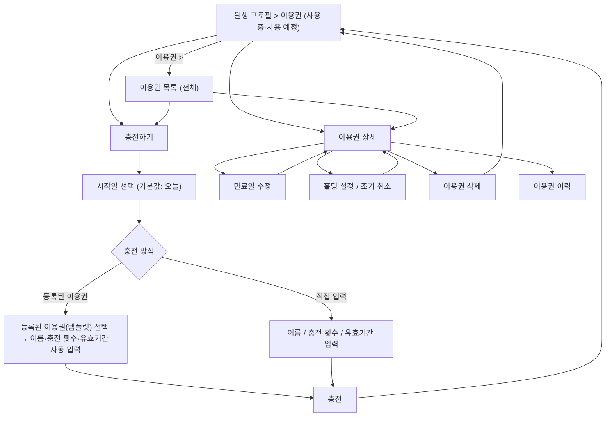
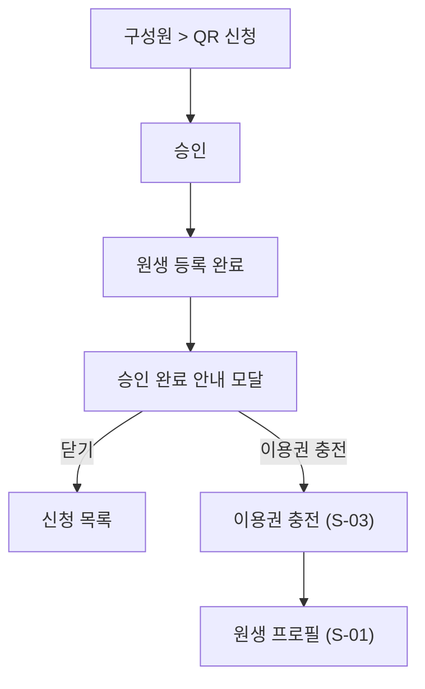

# [KD3-643] 충전 및 관리

관련 에픽: [KD3-566] 4.0 유치원 이용 여정 확장 (https://app.notion.com/p/KD3-566-4-0-3fe6c15f67fb8080babbefb5564d8c2a?pvs=21)
분류: 원장
문서 상태: 최신
담당: PM_서현
지라 티켓: https://jira-knockdog.atlassian.net/browse/KD3-636
최종 편집 일시: 2026년 11월 2일 오후 6:21

- 변경이력
    
    2026-10-30
    
    - 등원 가능 시간 설정 여부와 관계없이 QR 신청을 승인할 수 있도록 변경(미설정 모달 삭제)
    
    2026-10-31
    
    - 이용권 이력에서 예약한 시간을 노출하지 않고 등원예정일만 목록에 뜨도록 변경
    
    2026-11-02
    
    - 이용권 상태에서 '소진'을 없애고 '만료'로 통일(잔여 횟수를 다 쓴 이용권도 만료로 표시)
    - 7장 화면 구성 및 UX 문구를 Figma 기준으로 수정(S-01 상단·탭 구성, S-02 상태칩 개수, S-03 입력 순서·등록된 이용권·시작일 선택, S-04 상세 구성, S-06 홀딩 기간 선택, S-07 승인 완료 안내 모달)
    - 3장 흐름도를 Figma 기준으로 수정(충전 시 시작일 먼저 선택, QR 승인 시 원생 등록 완료 후 승인 완료 안내 모달에서 충전)
    - 용어 정리: 충전 화면의 템플릿을 '등록된 이용권(템플릿)'으로 표기
    - 홀딩 예정 종료(자동 재개) 보호자 알림 N-07 추가, 이용권 삭제는 보호자에게 알리지 않기로 확정(미결 사항에서 제거)

## 1. 개요

### 1.1. 한 줄 요약

원장이 현장에서 결제를 마친 원생(강아지)에게 `원생 목록 > 프로필` 또는 `QR 신청 승인` 화면에서 이용권을 충전하고 충전한 이용권을 조회·삭제·홀딩하며 이력을 확인할 수 있게 한다.

### 1.2. 도입 배경

- 현재 상황
    - 결제·계약은 현장(앱 밖)에서 이루어지고 원장은 이용권 잔여 횟수를 수기로 관리한다.
    - v4.0에서 이용권을 원생(강아지) 단위 횟수권으로 도입하고 등원예약에서 이용권을 차감한다.
- 문제
    - 앱 안에 이용권 데이터가 없으면 등원예약에서 차감할 근거가 없고, 원장은 잔여 횟수를 따로 관리해야 한다.

### 1.3. 도입 목적

- 원장이 원생 프로필에서 이용권을 바로 충전해, 등원예약에서 차감할 수 있는 자격 데이터를 만든다.
- 등록된 이용권(템플릿) 선택 또는 직접 입력 중 편한 방식으로 충전할 수 있게 한다.
- QR 신청을 승인한 뒤 바로 충전할 수 있게 한다.
- 충전한 이용권의 상태·잔여·만료일·이력을 한 곳에서 확인하고, 필요하면 삭제·홀딩할 수 있게 한다.

### 1.4. 관련 문서

- [이용권 정의](https://app.notion.com/p/3ff6c15f67fb800d89c6cd89a128290d?pvs=21): 이용권의 정의·속성·라이프사이클(홀딩 포함). 이 문서의 용어·데이터 모델은 해당 문서를 따른다.
- [**[KD3-636] 이용권 등록**](https://app.notion.com/p/KD3-636-4006c15f67fb80219f7ee5a6ffa8b84b?pvs=21): 충전 시 불러오는 템플릿의 생성·수정·삭제
- [PRD 4.0 ](https://app.notion.com/p/PRD-4-0-3f66c15f67fb80cc93e1d838b4f5a91b?pvs=21), [IA 4.0 ](https://app.notion.com/p/IA-4-0-3f66c15f67fb8093b206e84646ac4a6b?pvs=21): v4.0 범위·화면 단위
- 등원예약 PRD: 이용권 차감·반환, 사용할 이용권 선택 (작성 필요)

## 2. 범위

### 2.1. 이 문서가 다루는 범위

- 원장 앱 `구성원` > `원생 목록` > `원생 프로필` > `이용 정보` > `이용권`
    - 이용권 목록·상세 조회
    - 이용권 충전(등록된 이용권으로 충전·직접 입력 충전)
    - 이용권 삭제
    - 홀딩 설정·조기 취소
    - 만료일 수정(연장)
    - 이용권 이력(충전·사용·사용 취소·홀딩·홀딩 해제·연장·만료)
- 원장 앱 `구성원` > `신청` > `QR 신청` > `승인`
    - 승인으로 원생 등록을 마친 뒤 이어서 이용권을 충전하는 흐름(충전 없이 닫는 것도 가능)
    - 첫 등원 처리와 이용권 차감은 다음 PRD(등원예약)에서 정의한다.

### 2.2. 제외 범위

| 제외 항목 | 제외 사유 | 후속 위치 |
| --- | --- | --- |
| 이용권 템플릿 생성·수정·삭제 | 마이페이지 > 이용권 관리에서 이뤄지는 별도 기능이다. | [이용권] 이용권 템플릿 PRD |
| 이용권 차감·반환(QR 승인 후 첫 등원 처리 포함), 사용할 이용권 선택 | 이용권을 언제·어떻게 쓰는지는 등원예약의 책임 범위다. | 등원예약 PRD |
| QR 연결 신청 자체(신청·거절·원생 등록) | 연결 신청 기능의 범위다. 이 문서는 승인 시점의 충전만 다룬다. | QR 연결 신청 PRD |
| 퇴원·연동 해제 | 퇴원 기능의 범위다. 
⚠️ 참고: 남은 이용권이 있으면 연동 해제할 수 없고, 만료된 이용권만 있으면 연동 해제할 수 있다. | 퇴원·연동 해제 PRD |
| 인앱 결제·환불 | v4.0은 앱 밖에서 결제하고 원장이 수동으로 충전한다. | v4.0 이후 |

## 3. 사용자 흐름

### 3.1. 원생 프로필에서 충전·관리

### 3.2. QR 신청 승인 시 충전

- 승인하면 바로 원생 등록이 완료된다. 승인 완료 안내 모달에서 닫기를 누르면 충전 없이 등록만 유지되고, 이후 원생 프로필에서 충전할 수 있다.
- 첫 등원 처리와 이용권 차감은 다음 PRD(등원예약)에서 정의한다.

## 4. 기능 요구사항

| ID | 요구사항 | 기능 | 정책 |
| --- | --- | --- | --- |
| FR-01 | 이용권 목록 조회 | 원장은 원생 프로필에서 그 원생이 가진 이용권을 목록으로 확인할 수 있다. |   • 이용권마다 이름·잔여/충전 횟수·시작일·만료일(또는 만료 없음)·상태를 표시한다
  **• 상태: 사용 예정·사용 중·홀딩 중·만료**
  • 잔여 횟수를 다 쓴 이용권도 '만료'로 표시한다
  • 한 원생이 여러 이용권을 가질 수 있다
  • 정렬: 등록일시 오름차순(가장 먼저 충전한 이용권이 위) |
| FR-02 | 등록된 이용권(템플릿)으로 충전 | 원장은 등록된 이용권(템플릿)을 골라 충전할 수 있다. |   • 등록된 이용권을 고르면 이름·충전 횟수·유효기간이 자동으로 채워진다
  • 등록된 이용권 목록 순서는 템플릿 PRD와 같다(생성일시 오름차순, 기본 템플릿 `체험 등원(1회권)`이 최상단)
  • 충전 시점의 값을 복사하는 스냅샷 방식이다. 이후 템플릿을 수정·삭제해도 충전한 이용권은 바뀌지 않는다
  • 등록된 이용권으로 불러온 값(이름·충전 횟수·유효기간)은 수정할 수 없다. 시작일만 정한다. 
  • 등록된 이용권 바텀시트 위쪽에 '등록된 이용권 / 직접입력' 메뉴가 있다. 직접입력을 고르면 직접 입력 방식으로 바뀐다. 다른 이용권을 고르면 자동으로 채워진 값이 바뀐다. |
| FR-03 | 직접 입력으로 충전 | 원장은 등록된 이용권 없이 이름·충전 횟수·유효기간을 직접 입력해 충전할 수 있다. |   • 이용권 이름: 최대 50자
  • 충전 횟수: 1~1000 정수
  • 유효기간: 선택 입력. 기간 칩(만료 없음·1개월·3개월·6개월·12개월) 또는 직접 입력(숫자 + 일·개월) |
| FR-04 | 시작일 설정 | 원장은 충전할 때 이용권 시작일을 정할 수 있다. |   • 바텀시트에서 시작일을 선택할 수 있다.
  • 과거·미래 날짜 모두 선택할 수 있다
  • 유효기간이 있으면 시작일 기준으로 만료일을 계산한다
  • 시작일이 아직 오지 않은 이용권은 '사용 예정' 상태다. 사용 예정 이용권으로 예약할 수 없다 |
| FR-05 | 충전 결과 | 충전하면 원생에게 새 이용권이 하나 생성된다. |   • 기존 이용권에 횟수를 더하지 않고 항상 새 이용권을 만든다
  • 잔여 횟수 초기값 = 충전 횟수
  • 충전일을 기록한다 |
| FR-06 | 이용권 수정(만료일 수정) | 사용 중인 이용권의 만료일을 수정할 수 있다.  |   • 사용중인 이용권을 수정할 수 있다
  • 수정 실패 시 기존 만료일을 유지한다
  • 연필 버튼 클릭 시 만료일 날짜 재설정 가능하다
  • 만료일은 기존에 설정한 만료일 이후의 날짜만 선택 가능하다 |
| FR-07 | 이용권 삭제 | 원장은 충전한 이용권을 삭제할 수 있다. |   • 삭제 전 확인 모달을 표시한다
  • 삭제하면 이용권과 그 이력이 목록에서 완전히 지워진다 |
| FR-08 | 홀딩 설정 | 원장은 이용권별로 시작일·종료일을 정해 사용을 중단시킬 수 있다. |   • 홀딩 중인 이용권으로는 등원예약을 할 수 없다. 같은 원생의 다른 이용권은 쓸 수 있다
  • 홀딩 기간 동안 만료일 카운트가 멈추고 잔여 횟수는 유지된다
  • 예정 종료일을 채우면 다음 날부터 남은 일수만큼 다시 계산된다
  • 만료일이 없는 이용권과 사용 예정 이용권은 홀딩할 수 없다(비활성화)
  • 반복 적용할 수 있다 |
| FR-09 | 홀딩 조기 취소 | 원장은 진행 중인 홀딩을 중도에 취소할 수 있다. |   • 취소하면 그날부터 바로 풀리고, 남은 일수가 취소 당일부터(당일 포함) 다시 계산된다. |
| FR-10 | 이용권 이력 | 원장은 이용권 상세에서 이용권별 이력을 확인할 수 있다. |   • `충전`, `사용`, `사용 취소`, `홀딩`, `홀딩 해제`, `연장`, `만료` 이력을 확인할 수 있다. 
  • 최신 이력이 위에 오도록 발생일 내림차순으로 정렬한다
  • 등원 결과(등원·결석·노쇼)는 이력에 표시하지 않는다
  • 표기 형식은 5장 이용권 이력 유형을 따른다 |
| FR-11 | QR 신청 승인 시 충전 | 원장이 QR 신청을 승인하면 원생 등록이 완료되고, 이어서 이용권을 충전할 수 있다. |   • 승인하면 승인 완료 안내 모달을 띄운다(7장 S-07)
  • 충전은 선택이다. 모달에서 닫기를 누르면 원생 등록만 유지되고, 이후 원생 프로필에서 충전할 수 있다
  • 충전하는 경우 충전 방식·입력 항목은 FR-02~FR-05와 같다 |

## 5. 입력 및 데이터 항목

**충전 시 입력 필드**

| 항목 | 필수 | 정책 |
| --- | --- | --- |
| 대상 원생 | Y | 원생 프로필 또는 QR 신청 승인 화면에서 진입하므로 따로 고르지 않는다. |
| 이용권 이름 | Y | 한 줄 자유 텍스트, 최대 50자. 등록된 이용권 선택 시 자동 입력 |
| 충전 횟수 | Y | 1~1000 정수. 등록된 이용권 선택 시 자동 입력 |
| 시작일 | Y | 기본값 오늘. 과거·미래 날짜 모두 선택 가능. 만료일 계산 기준 |
| 유효기간 | N | 기간 칩 또는 직접 입력(숫자 + 일·개월). 설정하지 않으면 만료 없음. 등록된 이용권 선택 시 자동 입력 |

**시스템 관리 필드**

| 항목 | 기준 |
| --- | --- |
| 잔여 횟수 |   • 초기값 = 충전 횟수
  • 등원 예약 시 차감 |
| 만료일 |   • 시작일 + 유효기간. 
  • 홀딩이 끝나면 남은 일수로 다시 계산한다. 
  • 유효기간이 없으면 비어 있다 |
| 상태 | 아래 상태 정의 참고 |
| 등록일 | 변경 이력 추적용 |
| 홀딩 이력 | 홀딩 시작일·예정 종료일·시작 시점 남은 일수·종료 방식·실제 종료일 (이용권 정의 5장) |

**이용권 상태 정의**

| 상태 | 정의 | 다음 상태 |
| --- | --- | --- |
| 사용 예정 | 시작일이 아직 오지 않은 이용권 | 시작일이 되면 사용 중 |
| 사용 중 | 시작일이 지났고, 잔여 횟수가 1 이상이며, 만료일 전(또는 만료 없음). 이용권 정의 문서의 '활성'에 해당 | 홀딩 중 / 만료 |
| 홀딩 중 | 원장이 지정한 기간 동안 사용이 멈춘 이용권. 만료일 카운트가 멈추고 잔여 횟수는 유지 | 예정 종료일 다음 날 또는 조기 취소 당일 사용 중 |
| 만료 | 잔여 횟수가 0이 됐거나, 만료일이 지남(잔여 횟수가 남아 있어도 전환) | 없음. 다시 쓰려면 새로 충전 |

**이용권 이력 유형**

| 유형 | 생기는 경우 | 제목 | 상세 |
| --- | --- | --- | --- |
| 충전 | 원장이 이용권을 충전함 | 충전 | {충전일}  |
| 사용 | 예약 발생 | 사용({n}회)

예약해서 횟수가 1회 차감됨 | {M/D}({요일}) 등원 |
| 사용 취소 | 예약 취소로 차감했던 1회를 돌려받음. 원래 사용 기록의 제목에 취소선을
긋고, 원래 기록은 지우지 않음 | ~~사용({n}회)~~ |  {M/D}({요일}) 예약 취소 |
| 홀딩 | 원장이 홀딩을 설정함 | 홀딩 | 기간 {시작일} ~ {종료일} |
| 홀딩 해제 | 원장이 조기 해제 | 홀딩 해제 | ~ 만료일 |
| 연장 | 원장이 기간 만료 전에 이용권 기간을 늘렸을 때 | 연장 | 만료일 2026.12.31 변경 |
| 만료 | 만료일이 지나 남은 횟수가 사라짐 or 소진된 경우  | 만료 | 만료일 |

- 등원 결과(등원·결석·노쇼)는 표시하지 않는다.
- 입력·검사·오류 처리는 7.1의 공통 정책을 따른다.

## 6. 알림

| ID | 트리거(발송 기준) | 수신자 | 알림 문구(제목 / 본문) | 이동 · 채널 |
| --- | --- | --- | --- | --- |
| N-01 | 이용권 중 등원 시작일이 오늘인 경우

발송 기준: 이용권(시작:오늘) 생성 완료 or 오늘이 등원 시작일 9AM | 보호자 | **{강아지 이름}의 이용권이 충전됐어요**
{이용권 이름(10자+...} {n}회로 등원을 예약해 보세요. | 예약 탭 · 푸시 O / 알림함 O |
|  | 원장이 사용 예정인 이용권을 충전함 | 보호자 | **{강아지 이름}의 이용권이 충전됐어요**
{M월 D일}부터 등원을 예약할 수 있어요.  | 예약 탭 · 푸시 O / 알림함 O |
| N-02 | 원장이 홀딩을 설정함(S-06 적용 완료) | 보호자 | **{강아지 이름}의 이용권이 홀딩됐어요**
{M월 D일} ~ {M월 D일}에는 이 이용권으로 예약할 수 없어요. | 예약 탭 · 푸시 O / 알림함 O |
| N-03 | 원장이 홀딩을 조기 취소함 | 보호자 | **{강아지 이름}의 이용권을 다시 쓸 수 있어요**
오늘부터 등원 예약을 할 수 있어요. | 예약 탭 · 푸시 O / 알림함 O |
| N-04 | 원장이 만료일을 수정함(연장 저장 완료) | 보호자 | **{강아지 이름}의 이용권 기간이 늘어났어요**
만료일이 {M월 D일}로 바뀌었어요. | 예약 탭 · 푸시 O / 알림함 O |
| N-05 | 사용 중인 이용권의 만료 3일 전, 1일 전 오전 9시(잔여 1회 이상일 때만) | 보호자 | **{강아지 이름}의 이용권이 곧 끝나요**
{M월 D일}에 이용권이 만료돼요.  | 예약 탭 · 푸시 O / 알림함 O |
| N-06 | N-05와 같은 시점. 같은 날 여러 마리면 1건으로 묶음 | 원장 | **이용권 만료 예정**
{원생 이름}의 이용권이 {M월 D일}에 만료돼요.

**이용권 만료 예정**
{원생 이름} 외 {n}마리의 이용권이 3일 안에 만료돼요. | 원생 프로필 > 구성원(만료예정)
· 푸시 O / 알림함 O |
| N-07 | 홀딩 예정 종료일이 지나 홀딩이 자동으로 끝남

발송 기준: 홀딩 예정 종료일 다음 날 오전 9시 | 보호자 | **{강아지 이름}의 이용권을 다시 쓸 수 있어요**
홀딩 기간이 끝나 오늘부터 등원 예약을 할 수 있어요. | 예약 탭 · 푸시 O / 알림함 O |
- 기준: 3.0 [알림 정책](https://app.notion.com/p/3936c15f67fb80fa933cdffbf3ac2292?pvs=21)과 [UX 라이팅](https://app.notion.com/p/UX-3876c15f67fb80ceae97daa034fcc96e?pvs=21)(g. 알림 푸시)를 따른다.
- 톤: 보호자향은 강아지 이름을 주어로 다정하게, 원장향은 사실 중심으로 짧게. 제목에는 마침표를 쓰지 않고 본문에는 쓴다. '홀딩'은 보호자 문구에서 '잠시 멈추기'로 풀어 쓴다.
- 조사: 강아지 이름 끝에 받침이 있으면 '이'를 붙이고 조사는 받침 없는 이름 기준으로 쓴다(예: 콩 → 콩이의).
- 날짜는 ‘M월 D일’(올해), 작년 이전은 ‘YYYY년 M월 D일’로 쓴다. 내일이면 '내일'로 쓴다.
- 원장 본인이 한 충전·삭제·홀딩·연장은 화면 토스트로만 알리고 원장에게 푸시는 보내지 않는다.
- 이용권 삭제, 사용 예정 → 사용 중 전환, 만료는 보호자에게 푸시를 보내지 않는다.
- 보호자 잔여 1회 이하 알림은 [[KD3-658 ] 보호자 등원예약](https://app.notion.com/p/KD3-658-4066c15f67fb808b91b6f5461f50a319?pvs=21) N-03을 따른다(중복 발송하지 않음).
- 알림을 눌렀는데 대상 화면에 접근할 수 없으면(이용권 삭제·연결 해제 등) 홈으로 이동한다(알림 정책).

## 7. 화면 구성 및 UX 문구

| ID | 화면명 | 상태 | 기본 화면 구성 | 표시·동작 및 이동 | UX 문구 |
| --- | --- | --- | --- | --- | --- |
| S-01 | 원생 프로필 > 이용권 | 기본 | 상단 바(타이틀 '원생 프로필', 오른쪽 연결 해제 버튼), 프로필 요약(프로필 이미지·강아지 이름·보호자 전화번호), 탭(이용 정보·보호자 정보·등하원 기록·메모), 이용 정보 탭(이용권 섹션·기본 정보·연결 내역) |   • '이용 정보' 탭이 기본으로 선택된다.
  • 보호자 전화번호는 연결된 보호자
정보로 표시하고, 없으면 공통 미등록 정보 표시 정책을 따른다.
  • 이용권 섹션에는 사용중·사용예정 이용권만 노출한다. 홀딩중·만료 이용권은 S-02에서 확인한다.
  • 카드마다 이름·상태·잔여/충전 횟수·기간·남은 일수를 표시한다. 사용중 이용권의 잔여 횟수는 포인트 컬러로 강조한다.
  • 카드를 누르면 S-04, 섹션 제목의 '>'를 누르면 S-02, 충전하기를 누르면 S-03으로 이동한다.
  • 연결 해제는 원장 연결 해제 PRD를
따른다. | 타이틀: 원생 프로필
버튼: 연결 해제
탭: 이용 정보 · 보호자 정보 · 등하원 기록 · 메모
섹션 제목: 이용권
버튼(>) : 이용권 목록 이동 버튼
카드 1줄: 잔여 {n}회 / {m}회
카드 2줄: {시작일} ~ {만료일} · {n}일 남음 / {시작일} ~ 만료 없음
상태 배지: 사용중 · 사용예정
버튼: 충전하기 |
|  | 원생 프로필 > 이용권 / 이용권 목록 | 목록 없음 | 빈 상태, 충전하기 버튼 | S-01은 사용중·사용예정 이용권이 없을 때, S-02는 이용권이 하나도 없을 때 같은 빈 상태를 표시한다. | 제목: 아직 사용중인 이용권이 없어요
본문: 이용권을 충전하면 등원 예약이 가능해요.
버튼: 충전하기 |
| S-02 | 이용권 목록 상세 | 목록 | 전체 이용권 목록 |   • 원생의 전체 이용권을 노출한다. 
  • 상태칩마다 해당 이용권 개수를 표시한다. '전체'가 기본 선택이고, 칩을 고르면 해당 상태의 이용권만 보여준다.
  • 카드 표시와 이동은 S-01과 같다. 충전하기를 누르면 S-03로 이동한다. | 섹션 제목: 이용권 목록
상태칩: 전체 {n} · 사용중 {n} · 사용예정 {n} · 홀딩중 {n} · 만료 {n} (한 줄, 가로 스크롤)
카드 정보: 이용권 이름
카드 보조 정보: S-01과 같은 형식
상태 배지: 사용중 · 사용예정 · 홀딩중 · 만료
버튼: 충전하기 (상단 바 오른쪽) |
|  | 이용권 목록 상세 | 필터 결과 없음 | 상태칩 유지, 빈 상태 안내 | 선택한 상태칩에 해당하는 이용권이 없으면 목록 자리에 안내를 표시한다. | 제목: {상태} 이용권이 없어요 (예: 홀딩중인 이용권이 없어요) |
| S-03 | 이용권 충전 | 기본 | 시작일, 등록된 이용권 (선택), 이용권 이름, 충전 횟수, 유효기간, 만료일 안내, 충전하기 버튼 |   • 시작일은 오늘이 기본으로 채워져 있고, 누르면 시작일 선택 바텀시트를 연다.
  • 등록된 이용권을 누르면 등록된 이용권 바텀시트를 연다.
  • 유효기간에서 '직접 입력'을 고르면 숫자와 단위(일·개월) 입력 칸이 나타난다.
  • 시작일이나 유효기간이 바뀌면 만료일 안내가 바로 바뀐다.
  • 필수값이 모두 유효하면 충전하기 버튼이 활성화된다.
  • 충전하면 S-01로 돌아가 토스트를 표시한다. | 타이틀: 이용권 충전
라벨: 시작일 · 등록된 이용권 (선택) · 이용권 이름 · 충전 횟수 · 유효기간
시작일 값: {[YYYY.MM](http://YYYY.MM).DD} (오늘)
플레이스홀더: 시작일 선택하기 · 이용권 선택하기 · 이름을 입력하세요 · 횟수를 입력하세요
글자 수: {n}/50
단위: 회
유효기간 칩: 만료 없음 · 1개월 · 3개월 · 6개월 · 12개월 · 직접 입력
직접 입력 단위: 일 · 개월
만료일 안내: * {시작일}부터 사용하고 {만료일}에 만료돼요
버튼: 충전하기
Toast: 이용권을 충전했어요 |
|  | 이용권 충전 | 시작일 선택 | 바텀시트, 캘린더, 오늘 버튼, 선택 버튼 |   • 과거·미래 날짜 모두 고를 수 있다.
  • '오늘'을 누르면 캘린더가 오늘 날짜로 이동한다.
  • 고른 날짜를 강조하고, 버튼 문구가 그 날짜로 바뀐다.
  • 버튼을 누르면 시작일에 반영하고 바텀시트를 닫는다. 닫기 전까지 기존 시작일은 유지된다. | 제목: 시작일 선택
버튼: 오늘
CTA: {YYYY년 M월 D일} 선택 |
|  | 이용권 충전 | 등록된 이용권 선택 | 바텀시트, 상단 메뉴(등록된 이용권 / 직접입력), 등록된 이용권 목록 |   • 목록 순서는 템플릿 PRD와 같다(생성일시 오름차순).
  • 항목마다 이름·충전 횟수·유효기간을 표시한다.
  • 항목을 고르면 주황색 테두리로 표시하고, 값을 채운 뒤 바텀시트를 닫는다. 다른 항목을 고르면 채운 값이 바뀐다.
  • '직접입력'을 고르면 직접 입력 방식으로 바뀐다. | 제목: 등록된 이용권
메뉴: 등록된 이용권 · 직접입력
항목 보조 정보: {n}회 • {유효기간} / {n}회 • 만료 없음 |
|  | 이용권 충전 | 등록된 이용권 적용 | 기본 화면과 같음. 이름·충전 횟수·유효기간 비활성 | 자동으로 채운 이름·충전 횟수·유효기간은 수정할 수 없고 시작일만 바꿀 수 있다. 만료일 안내는 시작일 기준으로 바뀐다. | 안내: * 등록된 이용권은 시작일만 입력이 가능해요. |
|  | 이용권 충전 | 충전 횟수 범위 오류 | 기본 화면 유지 | 충전 횟수 필드를 벗어날 때 1~1000 정수인지 검사한다. 범위를 벗어나면 인라인 오류를 표시하고 충전하기 버튼을 비활성화한다. | 인라인 오류: 충전 횟수는 1~1000회 사이로 입력해 주세요. |
|  | 이용권 충전 | 작성 중 이탈 | 확인 모달 | 입력한 값이 있는 상태에서 뒤로 가면 확인 모달을 표시한다. | 제목: 충전하지 않고 나갈까요?
본문: 입력한 내용이 저장되지 않아요.
버튼: 닫기 · 나가기 |
|  | 이용권 충전 | 충전 실패 | 기본 화면 유지 | 화면과 입력값을 유지하고 충전하기 버튼을 다시 활성화한다. | Toast: 이용권을 충전하지 못했어요 |
| S-04 | 이용권 상세 | 기본 | 상단 바(이용권 이름, 오른쪽 휴지통 아이콘), 요약(상태 배지·잔여 횟수·기간·남은 일수), 이용권 정보(충전 횟수·시작일·충전일·만료일), 이용권 관리(안내·홀딩 버튼), 이용권 이력 |   • 사용중 이용권은 잔여 횟수를 포인트 컬러로 강조한다.
  • 충전일 옆에 충전한 담당자 이름을 표시한다.
  • 사용중 이용권은 만료일 옆 연필 아이콘을 누르면 만료일 수정 바텀시트를 연다.
  • 홀딩하기를 누르면 S-06를 연다. 홀딩중 이용권은 '홀딩 취소하기'를 누르면 홀딩 취소 모달을 띄운다.
  • 만료일이 없는 이용권, 사용예정 이용권, 만료된 이용권은 홀딩하기를 비활성화하고 이유를 안내한다.
  • 휴지통 아이콘을 누르면 S-05를 표시한다.
  • 이력은 5장 이용권 이력 유형의 표기를 따른다. | 타이틀: {이용권 이름}
요약: 잔여 {n}회 / {m}회 · {시작일} ~ {만료일} · {n}일 남음
정보 라벨: 충전 횟수 · 시작일 · 충전일 · 만료일
충전일 표기: {충전일} · {담당자 이름}
만료일 표기: {만료일} ({n}일 남음) / 만료 없음
섹션 제목: 이용권 관리
안내: 홀딩 기간 중에는 해당 이용권으로 예약할 수 없어요. 홀딩한 기간만큼 만료일이 연장돼요.
버튼: 홀딩하기 · 홀딩 취소하기
비활성 안내: 만료일이 없는 이용권은 홀딩할 수 없어요 / 사용 시작일({시작일}) 이후에 홀딩할 수 있어요 / 만료된 이용권은 홀딩할 수 없어요
섹션 제목: 이용권 이력 |
|  | 이용권 상세 | 만료일 수정 | 바텀시트, 만료일 선택, 수정하기 버튼 | 기존 만료일 이후 날짜만 고를 수 있다. 바뀌는 만료일과 연장 일수를 미리 보여준다. 수정하면 S-04로 돌아가 만료일이 바뀌고 이력에 '연장'이 추가된다. 수정에 실패하면 기존 만료일을 유지하고 토스트를 표시한다. | 제목: 만료일 수정
안내: * 기존 만료일({만료일}) 이후 날짜만 선택할 수 있어요.
라벨: 만료일
보조 정보: * {기존 만료일} → {새 만료일} ({n}일 연장)
버튼: 수정하기
Toast(실패): 만료일을 수정하지 못했어요 |
| S-05 | 이용권 삭제 | 확인 모달 | 제목, 본문, 닫기·삭제하기 버튼 | 삭제하기를 누르면 이용권을 삭제하고 S-01로 돌아가 토스트를 표시한다. | 제목: 이용권을 삭제할까요?
본문: 한 번 삭제한 이용권은 다시 불러올 수 없어요.
버튼: 닫기 · 삭제하기
Toast: 이용권을 삭제했어요 |
|  | 이용권 삭제 | 삭제 실패 | 상세 화면 유지 | 이용권을 삭제된 상태로 표시하지 않는다. | Toast: 이용권을 삭제하지 못했어요 |
| S-06 | 홀딩 설정 | 바텀시트 | 바텀시트, 홀딩 기간 필드, 안내, 홀딩하기 버튼 | 홀딩 기간 필드를 누르면 홀딩 기간 선택 바텀시트를 연다. 기간이 채워지면 홀딩하기 버튼이 활성화된다. 적용하면 S-04으로 돌아간다. | 제목: 이용권 홀딩
라벨: 홀딩 기간
플레이스홀더: 기간을 선택하세요
값: {[YYYY.MM](http://YYYY.MM).DD}–{[YYYY.MM](http://YYYY.MM).DD}
안내: * 홀딩 기간 중에는 해당 이용권으로 예약할 수 없어요. 홀딩한 기간만큼 만료일이 연장돼요.
버튼: 홀딩하기 |
|  | 홀딩 설정 | 홀딩 기간 선택 | 바텀시트, 시작일·종료일 탭, 캘린더, 기간 칩, 선택 완료하기 버튼 |   • 시작일·종료일을 캘린더에서 고르고, 그 사이 기간을 강조한다.
  • 기간 칩을 누르면 시작일부터 그만큼 종료일을 채운다.
  • 종료일은 시작일보다 앞설 수 없다.
  • 두 날짜가 모두 정해지면 버튼이 활성화되고, 누르면 홀딩 설정 바텀시트에 반영한다. | 제목: 홀딩 기간 선택
탭: 홀딩 시작일 · 홀딩 종료일
기간 칩: 직접 선택 · + 1개월 · + 3개월 · + 6개월 · + 12개월
버튼: 선택 완료하기 |
|  | 홀딩 취소 | 확인 모달 | 제목, 본문, 닫기·홀딩 취소 버튼 | 취소하면 오늘부터 바로 홀딩이 풀린다. | 제목: 홀딩을 취소할까요?
본문: 오늘부터 이용권을 다시 쓸 수 있어요.
버튼: 닫기 · 홀딩 취소 |
| S-07 | QR 신청 승인 › 이용권 충전 | 기본 | 구성원 > 신청 탭의 신청 목록 |   • 승인을 누르면 원생으로 등록된다.  | 버튼: 승인 · 거절  |
|  | QR 신청 승인 › 이용권 충전 | 승인 완료 안내 | 안내형 모달, 닫기·이용권 충전 버튼 |   • 승인으로 원생 등록이 끝난 직후 띄운다.
  • '이용권 충전'을 누르면 승인한 원생을 대상으로 S-03(이용권 충전)을 연다. 충전하면 해당 원생의 S-01로 이동해 토스트를 표시한다.
  • 닫기를 누르면 충전 없이 신청 목록으로 돌아간다. 원생 등록은 유지되고, 이후 원생 프로필(S-01)에서 충전할 수 있다.
  • S-03에서 충전하지 않고 나가도 원생 등록은 취소되지 않는다. | 제목: 원생 승인을 완료했어요
본문: {강아지 이름}의 유치원 연결이 완료됐어요.
버튼: 닫기 · 이용권 충전
Toast(충전 완료): 이용권을 충전했어요 |

### 7.1. 공통 정책 적용

- 입력값
    - 필수값 빈값 시 CTA 비활성, 최대 길이 초과 입력 차단, 정규화(앞뒤 공백 제거·연속 공백 1개), 인라인 오류 표시·해제는 [입력값 및 유효성 검사 정책](https://app.notion.com/p/39f6c15f67fb813fbc25c99b01e54990?pvs=21)을 따른다.
- 오류
    - 목록 조회 실패는 공통 네트워크 오류 화면, 충전·삭제·홀딩 실패는 액션 실패 기준, 다른 기기에서 이미 삭제된 이용권을 조작하는 경우는 이미 처리된 요청 기준을 따른다([오류 정책](https://app.notion.com/p/3986c15f67fb800a89a4c50c416e6e6b?pvs=21)).
- 로딩·중복 요청
    - [공통 로딩 정책](https://app.notion.com/p/3a76c15f67fb8073b0f4d07391bfd0fc?pvs=21)을 따른다. 충전하기 버튼은 중복 요청을 막는다.
- 용어
    - 이용권을 원생에게 넣는 행위는 '충전'으로 통일한다.
    - 충전 화면의 '등록된 이용권'은 마이페이지 > 이용권 관리에서 만든 이용권 템플릿을 말한다. 문서에서는 '등록된 이용권(템플릿)'으로 묶어 쓴다.
    - 기본 제공 1회권의 이름은 `체험 등원(1회권)`으로 통일한다.

## 8. 미결 사항

**A. 백엔드 확인**

- 상태 저장 방식: 별도 필드로 저장할지, 잔여 횟수·만료일·홀딩 이력으로 계산할지

**D. 참고**

- 3기 문서([원장 권한] 이용권 부여 등)는 v4.0과 구조가 달라 참조하지 않음