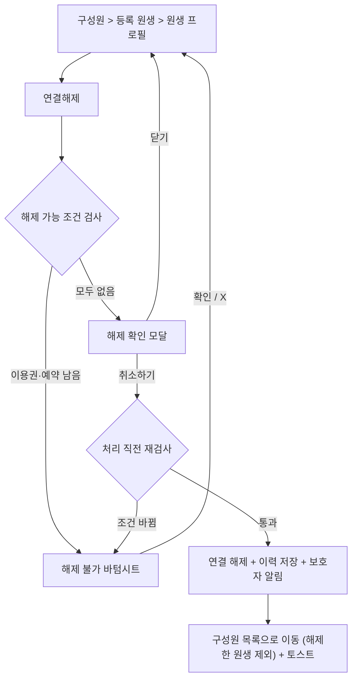

# [KD3-683] 원장 연결 해제

관련 에픽: [KD3-566] 4.0 유치원 이용 여정 확장 (https://app.notion.com/p/KD3-566-4-0-3fe6c15f67fb8080babbefb5564d8c2a?pvs=21)
분류: 원장
문서 상태: 변경 검토
담당: PM_서현
지라 티켓: https://jira-knockdog.atlassian.net/browse/KD3-683
최종 편집 일시: 2026년 11월 5일 오후 5:29

- 변경이력
    
    2026-11-01 초안 작성 (3.0·3.1 연결 해제, 보호자 연동해제 PRD, IA 확정 회의 기준)
    
    2026-11-01 기획 결정 반영: 하원 미처리 예약은 끝난 예약으로 봄, 이용권이 남으면 해제 불가(우회 없음), 예약이 남으면 예약일까지 해제 불가, 진입은 원생 프로필 상단만(목록 ⋯ 메뉴 삭제), 원장 권한 해제 기준은 이번 범위에서 제외
    
    2026-11-01 재연결 시 원생 프로필 연결 내역은 현재 연결 기간만 표시(지난 연결 기간 미노출)
    
    2026-11-01 해제 후 처리를 v3.0과 같게 변경: 해제한 원생은 구성원 목록에서 제외하고 원장은 원생·보호자 프로필에 접근할 수 없음. 보호자는 지난 이력을 읽기 전용으로 봄. 퇴원 상태·퇴원 필터 칩·퇴원 원생 프로필 삭제
    
    2026-11-05 피그마 디스크립션 기준으로 수정: 진입 경로를 구성원 > 등록 원생으로 변경, 상단 버튼을 연결해제로 변경, 해제 확인 모달 문구·버튼(닫기·취소하기)·토스트 변경, 해제 불가 바텀시트에 X 닫기·목록 스크롤·잔여 횟수 강조 추가, 처리 중 버튼 비활성화 추가
    

## 1. 개요

### 1.1. 한 줄 요약

원장이 원생 프로필에서 원생의 연결을 해제할 수 있게 하되, 사용할 수 있는 이용권이나 끝나지 않은 예약이 있으면 해제를 막고 이유를 보여준다. 원생은 원장의 구성원 목록에서 빠지고 원장은 원생·보호자 프로필에 접근할 수 없으며, 보호자는 지난 이력을 계속 볼 수 있다.

### 1.2. 도입 배경

- 현재 상황(v3.0·v3.1)
    - 원장은 `구성원` > `등록 원생` > `원생 프로필` 목록의 ⋯ 메뉴에서 연결 해제를 누르고 확인 모달에서 바로 해제한다([[KD3-34] 연결 상태 관리](https://app.notion.com/p/KD3-34-3826c15f67fb81d6a280e0d532ad3327?pvs=21)).
    - 해제한 원생은 구성원 목록에서 빠지고, 원장은 해제한 원생의 원생·보호자 정보에 접근할 수 없다([[KD3-39] 원생/보호자 정보](https://app.notion.com/p/KD3-39-3826c15f67fb81cb80cec29e1c261e2b?pvs=21) P-02).
    - 보호자는 해제 전 알림장·앨범을 읽기 전용으로 볼 수 있다.
    - 3.1에서 보호자 자진 해제가 추가됐다. 원장 승인 없이 바로 해제되고 원장에게 알림이 간다.
    - 해제를 막는 조건은 없다.
- v4.0에서 바뀌는 점
    - 이용권이 앱 안에서 관리되고, 예약할 때 이용권이 차감된다.
    - 한쪽에서 해제하면 양쪽 모두 해제된다.
    - 보호자 연동해제 PRD에서 해제 가능 조건을 정했고, 원장 해제도 같은 조건을 따르기로 했다([[KD3-663] 보호자 연결 해제](https://app.notion.com/p/KD3-663-4066c15f67fb80b3bcc7d3912a35e0c7?pvs=21) FR-09).
- 문제
    - 이용권이 남은 원생을 해제하면 결제한 횟수를 쓸 곳이 사라지고, 잡혀 있던 예약은 처리할 곳이 없어진다.

### 1.3. 도입 목적

- 사용할 수 있는 이용권이나 끝나지 않은 예약이 있으면 해제를 막아 결제한 횟수와 예약이 사라지지 않게 한다.
- 해제할 수 없을 때 이유와 언제 해제할 수 있는지 알려준다.
- 보호자 해제와 같은 조건·같은 결과를 갖게 해 어느 쪽에서 해제하든 상태가 같게 한다.
- 해제 후 처리(구성원 목록 제외, 원장 접근 차단, 보호자 이력 열람)는 v3.0 기준을 그대로 유지한다.

### 1.4. 관련 문서

- [[KD3-34] 연결 상태 관리](https://app.notion.com/p/KD3-34-3826c15f67fb81d6a280e0d532ad3327?pvs=21): v3.0 원장 연결 해제(영향 안내·해제 처리·기록 열람·상태 이력)
- [[KD3-39] 원생/보호자 정보](https://app.notion.com/p/KD3-39-3826c15f67fb81cb80cec29e1c261e2b?pvs=21): 원생 프로필 조회 권한(현재 연결 중인 원생만)
- [[KD3-663] 보호자 연결 해제](https://app.notion.com/p/KD3-663-4066c15f67fb80b3bcc7d3912a35e0c7?pvs=21): 보호자 해제, 해제 가능 조건(FR-03), 해제 후 보호자 열람(FR-07), 원장 해제 조건(FR-09)
- [[KD3-643] 충전 및 관리](https://app.notion.com/p/KD3-643-4006c15f67fb80ebbd74f4426582b49f?pvs=21): 이용권 상태
- [[KD3-658 ] 보호자 등원예약](https://app.notion.com/p/KD3-658-4066c15f67fb808b91b6f5461f50a319?pvs=21): 예약 상태, 예약 취소
- [[KD3-682] 등하원 처리](https://app.notion.com/p/KD3-682-4066c15f67fb808eaae4c4d271eb67d4?pvs=21): 등원·결석 처리, 자동 결석, 하원 미처리, 당일 연결 해제 원생(FR-14)
- [개인정보 처리방침 (2026. 09. 01. 개정)](https://app.notion.com/p/2026-09-01-3856c15f67fb802eaba0de1c6b647c31?pvs=21): 연결 해제 후 기록 보존
- [알림 정책](https://app.notion.com/p/3936c15f67fb80fa933cdffbf3ac2292?pvs=21), [UX 라이팅](https://app.notion.com/p/UX-3876c15f67fb80ceae97daa034fcc96e?pvs=21): 알림·문구 기준

## 2. 범위

### 2.1. 이 문서가 다루는 범위

- 원장 앱 `구성원` > `등록 원생` > `원생 프로필`
    - 연결 해제 진입(프로필 상단 오른쪽)
    - 해제 가능 조건 검사와 해제 불가 안내
    - 해제 확인 모달과 해제 처리
- 해제 후 원장 쪽 처리(구성원 목록 제외, 프로필 접근 차단)
- 해제 알림(원장 해제 → 보호자)

### 2.2. 제외 범위

| 제외 항목 | 제외 사유 | 후속 위치 |
| --- | --- | --- |
| 보호자 해제 화면, 해제 후 보호자 열람 화면 | 보호자 기능이다. 해제 가능 조건은 이 문서와 같다. | [[KD3-663] 보호자 연결 해제](https://app.notion.com/p/KD3-663-4066c15f67fb80b3bcc7d3912a35e0c7?pvs=21)  |
| 원장용 해제(퇴원) 원생 조회 | v3.0과 같이 해제한 원생은 원장에게 보여주지 않는다. | 백로그 |
| 남은 이용권 환불 | 결제·환불은 앱 밖에서 한다. | v4.0 이후 |
| 일괄 해제 | 잘못 조작할 영향이 크다(3.0 결정 유지). | 제외 |
| 해제 사유 입력 | 3.0에서 후속 검토로 남긴 항목이다. | 후속 검토 |
| 재연결(다시 입학) | 연결 신청·승인 기능의 범위다. 새 신청이 승인되면 새 연결을 만든다([KD3-34] P-12). | 연결 신청 PRD |

## 3. 3.x와 4.0 비교

| 항목 | v3.0·v3.1 (현재) | v4.0 |
| --- | --- | --- |
| 진입 | 구성원 > 구성원 목록 `⋯` 메뉴 > 연결 해제 | **변경**. 원생 프로필 상단 오른쪽 '연결해제'(개편 디자인). 구성원 목록의 ⋯ 메뉴는 없앤다 |
| 해제 조건 | 없음. 누르면 확인 모달 후 바로 해제 | **변경**. 사용할 수 있는 이용권과 끝나지 않은 예약이 모두 없을 때만 해제 |
| 해제 확인 | **모달 문구**
{강아지}의 유치원 연결을 해제하시겠어요? 
연결을 해제하면 더 이상 해당 원생의 일과를 수행할 수 없어요. | **문구만 변경**. 
원생과 보호자 정보를 볼 수 없다는 점을 안내하고 버튼을 닫기·취소하기로 쓴다(8장 S-03). '~하시겠어요?'는 UX 라이팅 기준에 맞춰 '~할까요?'로 바꾼다 |
| 해제 후 원장 | 구성원 목록에서 제외. 원생·보호자 프로필 접근 불가. 해제 내역 조회 없음 | **동일
당일 출결 이력은 유지하고 등원 이력이 있으면 일과에 연결해제 태그 표시** |
| 해제 후 보호자 | 지난 알림장·앨범 읽기 전용 | **동일**. 4.0에서 생긴 이용권 이력·연결 이력도 읽기 전용으로 볼 수 있음
[[KD3-663] 보호자 연결 해제](https://app.notion.com/p/KD3-663-4066c15f67fb80b3bcc7d3912a35e0c7?pvs=21)  |
| 연결 구조 | 강아지 1마리 = 유치원 1곳 | **동일** |
| 보호자 해제 | 3.1부터 원장 승인 없이 즉시 해제 | 같은 방식에 `해제 가능 조건`이 추가됨. 해제 후 원장 쪽 처리는 원장 해제와 같다 |

## 4. 사용자 흐름

## 5. 기능 요구사항

| ID | 요구사항 | 기능 | 정책 |
| --- | --- | --- | --- |
| FR-01 | 해제 진입 | 원장은 원생 프로필에서 연결해제 버튼을 누를 수 있다. |   • 원생 프로필 상단 오른쪽에 '연결해제' 버튼을 둔다. 진입점은 이곳 하나다
  • 구성원 목록 카드의 ⋯ 메뉴(v3.0)는 없앤다 |
| FR-02 | 해제 단위 | 원생 1마리씩 해제한다. |   • 일괄 해제는 없다 |
| FR-03 | 해제 가능 조건 | 사용할 수 있는 이용권과 끝나지 않은 예약이 모두 없을 때만 해제할 수 있다. |   • 기준은 보호자 연동해제 FR-03과 같다
  • 사용할 수 있는 이용권: 사용 예정·사용 중·홀딩 중. 만료된 이용권만 있거나 이용권이 없으면 해제할 수 있다
  • 끝난 예약: 결석(원장 결석·자동 결석), 하원 완료, 하원 처리를 하지 않은 예약일이 지난 등원 완료. 이 외의 예약(예약 확정·당일 등원 전·당일 재원 중)이 있으면 해제할 수 없다
  • 하원은 자동 처리하지 않지만, 예약일이 지나면 하원 처리 여부와 상관없이 끝난 예약으로 본다
  • 예약일이 지난 등원 전 예약은 다음 날 0시에 자동 결석되므로 해제를 막지 않는다([[KD3-682] 등하원 처리](https://app.notion.com/p/KD3-682-4066c15f67fb808eaae4c4d271eb67d4?pvs=21)  FR-09) |
| FR-04 | 해제 불가 안내 | 조건을 충족하지 못하면 해제할 수 없는 이유를 보여준다. |   • 남은 이용권은 이름·잔여 횟수·만료일을, 끝나지 않은 예약은 날짜·등원 예정 시간을 표시한다
  • 이용권과 예약이 모두 남아 있으면 두 목록을 함께 표시한다
  • 이용권이 남은 경우: 이용권을 다 쓰거나 삭제하거나 만료된 뒤에 해제할 수 있다.
  • 이용권이 여러 개면 목록 안에서 스크롤한다
  • 해제할 수 없는 동안 기존 연결 관계를 유지하고, 이용권 상태가 바뀌면 해제 가능 여부를 다시 확인한다
  • 예약이 남은 경우: 원장은 예약을 취소할 수 없으므로 예약일이 지나 예약이 끝날 때까지 해제할 수 없다. 보호자가 예약을 취소하면 그 전에 해제할 수 있다 |
| FR-05 | 해제 확인 | 해제 전에 해제 후 달라지는 점을 안내하고 확인을 받는다. |   • 원생과 보호자 정보를 볼 수 없다는 점을 안내한다
  • 해제를 확정하기 전까지 기존 원생 정보와 등록 상태를 유지한다 |
| FR-06 | 처리 직전 재검사 | 해제를 처리하기 직전에 조건을 다시 검사한다. |   • 확인 모달을 띄운 사이 보호자가 예약하거나 이용권이 충전되면 해제하지 않고 해제 불가 안내로 전환한다(보호자 연결 해제 FR-06과 같음) |
| FR-07 | 해제 처리 | 확인하면 바로 연결을 해제한다. |   • 연결 상태를 '연결 해제'로 바꾼다
  • 해제 주체(원장)·해제 일시·이전/이후 상태를 서비스 내부 상태 변경 이력으로 저장한다([KD3-34] KD-FR-CONN-COMMON-001)
  • 성공하면 확인 모달을 닫고 구성원 목록으로 이동한 뒤 성공 토스트를 표시한다
  • 실패하면 기존 연결 상태와 원생 프로필 화면을 유지하고 실패 토스트를 표시한다
  • 처리 중에는 중복 요청을 막기 위해 확인 버튼을 비활성화한다
  • 보호자에게 알림을 보낸다(7장)
  • 보호자 알림 발송에 실패해도 해제 결과는 유지한다([KD3-34] P-15) |
| FR-08 | 해제 후 원장 | 해제한 원생은 원장의 구성원 목록에서 빠지고, 원장은 원생·보호자 프로필에 접근할 수 없다. |   • v3.0 기준을 유지한다([KD3-34], [KD3-39] P-02)
  • 출결 이력은 유지한다. 등원 이력이 있으면 일과에 연결해제 태그 표시
  • 구성원 목록에 나오지 않는다. 
  • 원생 프로필(이용 정보·보호자 정보·등하원 기록)에 진입할 수 없다. 알림이나 열어 둔 화면 등으로 진입하면 연결 상태를 확인해 공통 오류 화면을 보여준다([KD3-39] E-03)
  • 원장용 해제 원생 조회·해제 내역 조회는 제공하지 않는다
  • 보호자가 먼저 해제한 경우도 같다 |
| FR-09 | 해제 후 보호자 | 보호자는 해제 전 이력을 읽기 전용으로 볼 수 있다. |   • v3.0 기준을 유지한다([KD3-34] P-10·P-11)
  • 지난 알림장·앨범·등하원 기록, 이용권 이력, 유치원 연결 이력을 볼 수 있다. 수정·새 예약은 할 수 없다
  • 화면 기준은 보호자 연동해제 PRD FR-07을 따른다 |
| FR-10 | 예약 당일 해제 | 그날 해제된 원생은 일과에서 처리할 수 없다. |   • 끝나지 않은 예약이 있으면 해제할 수 없으므로, 당일 해제는 그날 예약을 등원·결석으로 마친 뒤에만 생긴다 |
| FR-11 | 재연결 | 해제한 원생이 다시 연결 신청해 승인되면 새 연결을 만든다. |   • 기존 연결을 되살리지 않고 새 연결을 만든다([KD3-34] P-12)
  • 원생 프로필의 연결 내역에는 현재 연결 기간만 표시한다. 해제 전 지난 연결 기간과 등원 횟수는 원장에게 보여주지 않는다 |

## 6. 입력 및 데이터 항목

| 항목 | 기준 |
| --- | --- |
| 대상 원생 | 해제하는 원생 1마리 |
| 연결 상태 | 연결 완료 · 연결 해제 |
| 해제 주체 | 원장 · 보호자 |
| 해제 일시 | 해제를 처리한 시각. 서비스 내부 상태 변경 이력에 저장하며 원장에게는 보여주지 않는다 |

**연결 상태 정의**

| 상태 | 정의 | 다음 상태 |
| --- | --- | --- |
| 연결 완료 | 유치원과 원생의 연결이 활성화된 상태. 예약·일과·알림장·앨범 대상 | 원장 또는 보호자가 해제하면 연결 해제 |
| 연결 해제 | 원장 또는 보호자가 연결을 해제한 상태. 원장은 일과에서 등원 이력만 확인 가능, 보호자는 지난 이력을 읽기 전용으로 봄 | 새 연결 신청이 승인되면 새 연결로 연결 완료 |

## 7. 알림

| ID | 트리거(발송 기준) | 수신자 | 알림 문구(제목 / 본문) | 푸시 | 알림함 | 이동 | 변경 |
| --- | --- | --- | --- | --- | --- | --- | --- |
| N-01 | 원장이 원생 연결을 해제함 | 보호자 | 유치원 연결이 해제됐어요
기존 알림장은 똑독로그 탭에서 계속 확인할 수 있어요. | Y | Y | 유치원 탭 > 유치원 연결 이력 | 이동 위치 변경 |
|  | 보호자가 연결을 해제함 | 원장 | 보호자가 유치원과의 연결을 해제했어요
{강아지 이름}가 구성원 목록에서 제외됐어요. | Y | Y | 구성원 > 등록 원생 | 이동 위치 변경 |
- 유치원 이름은 10자까지 보여주고 넘으면 말줄임한다(알림 정책).
- 원장 본인에게는 푸시 없이 토스트만 보여준다.
- 조사: 강아지 이름 끝에 받침이 있으면 '이'를 붙이고 조사는 받침 없는 이름 기준으로 쓴다(콩 → 콩이의).

## 8. 화면 구성 및 UX 문구

| ID | 화면명 | 상태 | 기본 화면 구성 | 표시·동작 및 이동 | UX 문구 |
| --- | --- | --- | --- | --- | --- |
| S-01 | 원생 프로필 | 기본 | 상단 바(뒤로, 원생 프로필, 연결해제), 프로필, 탭(이용 정보 · 보호자 정보 · 등하원 기록) | 연결해제를 누르면 조건을 검사해 S-02 또는 S-03을 표시한다. | 상단 버튼: 연결해제 |
| S-02 | 해제 불가 | 이용권 남음 | 바텀시트(배경 Dim): 제목, X, 본문, 남은 이용권 목록, 버튼 |   • 확인(Orange Filled)이나 오른쪽 위 X를 누르면 닫고 원생 프로필을 유지한다.
  • 잔여 횟수는 주황색으로 강조한다.
  • 이용권이 여러 개면 목록 안에서 스크롤한다. | 제목: 아직 연결을 해제할 수 없어요
본문: 사용할 수 있는 이용권이 아직 남아 있어요. 이용권을 삭제하거나 만료된 뒤 해제할 수 있어요.
항목: {이용권 이름} + 오른쪽 {n}회 남음 / [YYYY.MM](http://YYYY.MM).DD까지 (또는 만료 없음)
버튼: 확인 |
|  | 해제 불가 | 예약 남음 | 바텀시트(배경 Dim): 제목, X, 본문, 예약 목록, 버튼 |   • 확인(Orange Filled)이나 오른쪽 위 X를 누르면 닫고 원생 프로필을 유지한다.
  • 이용권과 예약이 모두 남아 있으면 두 목록을 함께 표시한다. | 제목: 아직 연결을 해제할 수 없어요
본문: 완료되지 않은 예약이 남아 있어요. 예약한 날이 지나면 해제할 수 있어요.
항목: {유치원} 예약 / [YYYY.MM](http://YYYY.MM).DD 오후 h:mm 등원 예정 + 오른쪽 등원 전
버튼: 확인 |
| S-03 | 해제 확인 | 확인 모달 | 배경 Dim, 제목, 본문, 닫기·취소하기 버튼 |   • 취소하기를 누르면 재검사(FR-06) 후 해제하고 구성원 목록으로 이동해 토스트를 표시한다.
  • 닫기를 누르면 모달을 닫고 기존 연결 상태를 유지한다.
  • 처리 중에는 취소하기 버튼을 비활성화한다. | 제목: {원생 이름}의 연결을 해제할까요? (원생 이름 주황 강조)
본문: 연결 해제 시 원생과 보호자 정보를 볼 수 없어요.
버튼: 닫기(Gray Outline) · 취소하기(Orange Filled)
Toast: 연결 해제가 완료되었어요 |
|  | 해제 확인 | 조건 변경 | S-02로 전환 | FR-06 재검사에서 조건을 충족하지 못한 경우다. | S-02 문구를 따른다. |
|  | 해제 확인 | 해제 실패 | 모달 닫고 S-01 유지 | 연결 상태를 바꾸지 않는다. | Toast: 연결 해제를 완료하지 못했어요 |
|  | 해제 확인 | 이미 해제됨 | 구성원 목록으로 이동 | 다른 기기에서 원장이 해제했거나 보호자가 먼저 해제한 경우다. | Toast: 이미 연결을 해제한 원생이에요 |
| S-04 | 원생 프로필 | 접근 불가 | 공통 오류 화면(full-page) | 해제된 원생의 프로필에 진입하려 할 때 표시한다([KD3-39] E-03). | [KD3-39] M-06을 따른다. |

### 8.1. 공통 정책 적용

- 오류
    - 해제 실패 문구는 8장 S-03을 쓰고, 이미 해제된 원생은 이미 처리된 요청 기준을 따른다([오류 정책](https://app.notion.com/p/3986c15f67fb800a89a4c50c416e6e6b?pvs=21)).
- 로딩·중복 요청
    - [공통 로딩 정책](https://app.notion.com/p/3a76c15f67fb8073b0f4d07391bfd0fc?pvs=21)을 따른다. 처리 중에는 취소하기 버튼을 비활성화해 중복 요청을 막는다.
- 용어
    - 화면 문구는 '연결 해제'를 쓴다. 상단 버튼과 일과 태그만 '연결해제'로 붙여 쓴다. '연동'은 쓰지 않는다(UX 라이팅 금지 표현).